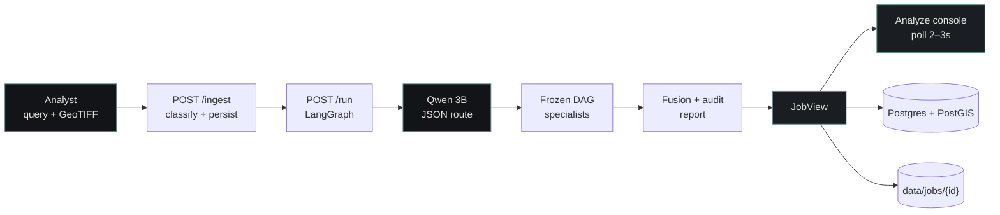
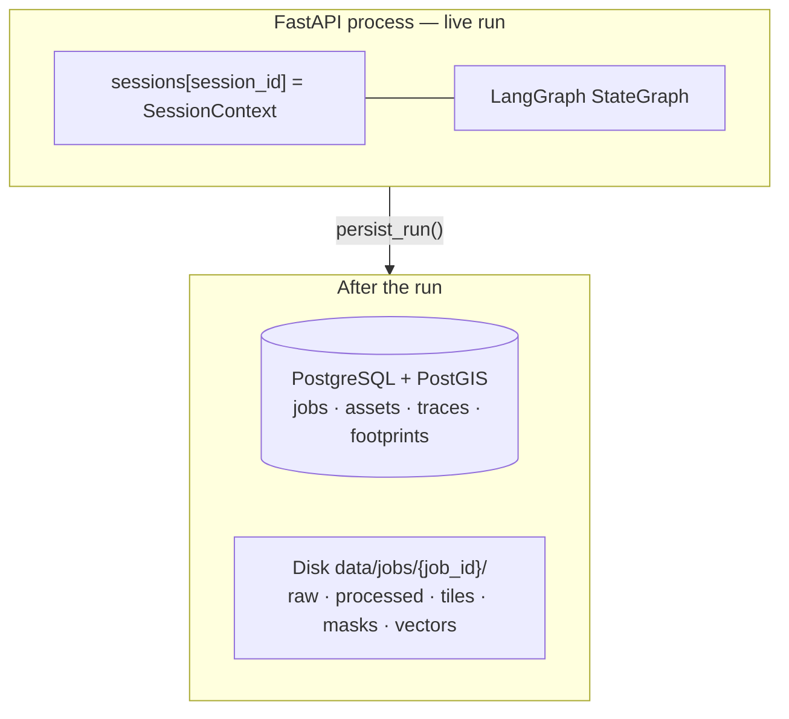
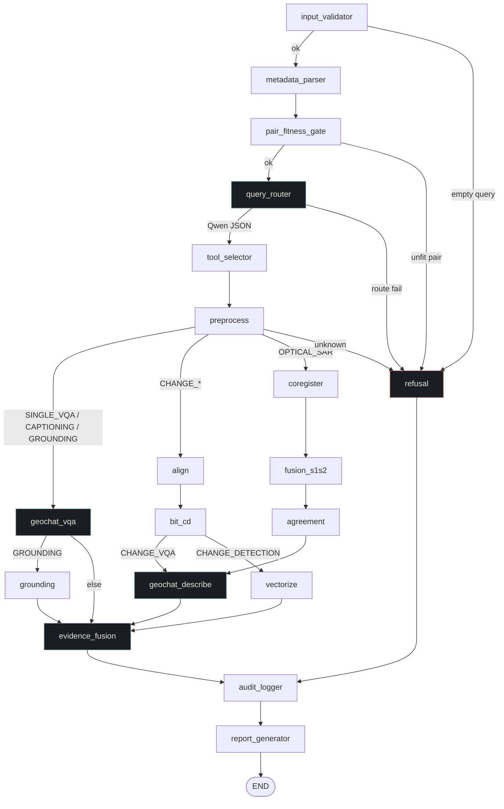
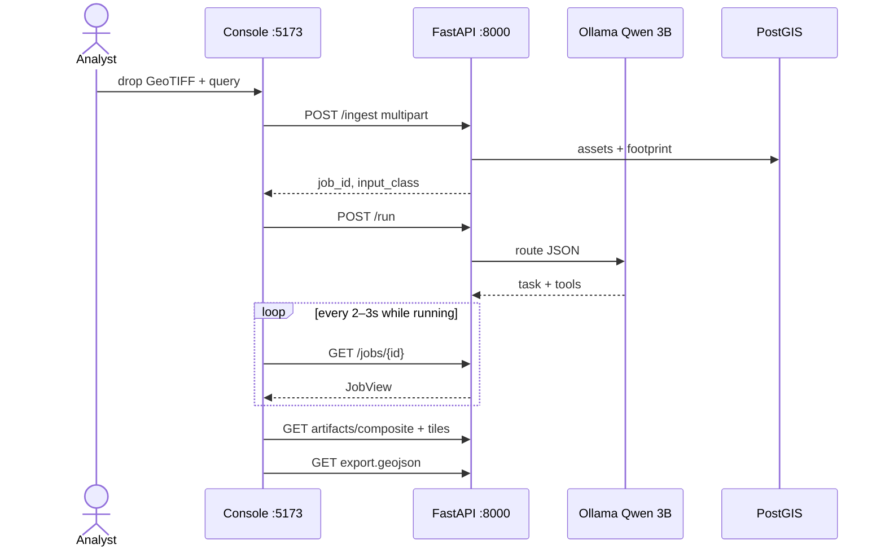

<div align="center">


<br/>

<!-- Animated typewriter — teal to match SatQuery primary #5E8F8A -->
<p align="center">
  
</p>

### Natural-language analysis for ISRO Earth-observation rasters

*Qwen2.5-3B JSON router · frozen LangGraph DAG · InternVL3-1B talking VLM · PostGIS evidence · Analyze ops console*

<br/>

[**API Spec**](./docs/api-spec.md)
&nbsp;·&nbsp;
[**Architecture**](./docs/SatQuery_AI_System_Architecture.md)
&nbsp;·&nbsp;
[**Docs**](./docs/README.md)
&nbsp;·&nbsp;
[**Contributing**](./CONTRIBUTING.md)
&nbsp;·&nbsp;
[**Security**](./SECURITY.md)
&nbsp;·&nbsp;
[**License**](./LICENSE)

<br/>

<!-- Stack -->
<p>
  
  
  
  
</p>

<!-- Frontend & GIS -->
<p>
  
  
  
  
  
</p>

<!-- Persistence & models -->
<p>
  
  
  
  
  
</p>

<!-- Meta -->
<p>
  
  
  
  
  
  
  
</p>

<br/>

[](https://github.com/amulyagavankar20-glitch/SatQuery)
[](./docs/api-spec.md)
[](./CONTRIBUTING.md)
[](./SECURITY.md)
[](./CODE_OF_CONDUCT.md)

</div>

---

> [!IMPORTANT]
> **Architecture locks.** The agent decides WHAT to run. Specialists analyse. GIS says WHERE.
> Router is **Qwen2.5-3B-Instruct** (text only, JSON schema, Ollama). Talking VLM is **InternVL3-1B** (replaces GeoChat-7B at implementation; graph tool IDs stay `geochat_vqa` / `geochat_describe`). Graph is a **frozen LangGraph StateGraph**. No Redis. No Kafka. No 30B orchestrator. Client polls `GET /jobs/{id}` — one document: **JobView**.

## What this is

SatQuery is an ISRO / DoS software problem statement agent for **SAC analysts**. Drop Cartosat, RISAT, or Sentinel GeoTIFFs, ask a question in English, and get a grounded answer plus spatial evidence — not a generic cloud VLM caption.

| You bring | SatQuery returns |
|---|---|
| One optical scene + query | Caption / VQA (`geochat_describe` / `geochat_vqa`) |
| Two dates, same AOI | Change path (`align` → `bit_cd` → vectorize / describe) |
| Optical + SAR pair | Fusion path (`coregister` → `fusion_s1s2` → agreement) |
| Phrase + scene | Grounding overlay (`geochat_vqa` → `grounding`) |

Configs the gate accepts: **single optical**, **single SAR**, **bi-temporal pair**, **co-registered optical + SAR**. Formats: GeoTIFF / TIFF.

## Pipeline



Live memory is an in-process `dict[session_id → SessionContext]`. When the graph ends, Postgres remembers the job; rasters stay on disk.



> [!NOTE]
> Process restart loses in-flight and un-persisted ingest sessions. Re-ingest the raster. Finished jobs live in Postgres. That is intentional for SIH — not a missing Redis.

## Frozen LangGraph

Conditional edges only. The graph never invents tools.



| Role | Runtime | Notes |
|---|---|---|
| Router | `qwen2.5:3b-instruct` via Ollama | Query + manifest → `{task, tools[], params}`. No pixels. |
| Talking VLM | `OpenGVLab/InternVL3-1B` | VQA, caption, weak grounding, change-crop describe. **Mock until loaded.** |
| Change mask | BIT | Silent pixel map. Language from the talking VLM on the crop. |
| Grounding fallback | MobileSAM | Prompted by the VLM phrase — not a second 7B. |
| Optical + SAR | Dual encoder + linear head | Not SkySense. |

> [!WARNING]
> BIT, SAM, and optical–SAR fusion still return **mock specialist results**. The talking VLM backend is `mock` until InternVL is loaded (`TALKING_VLM_BACKEND=internvl`). `GET /jobs/{id}/report.pdf` is **501**. The graph, JobView contract, ingest, router, and Analyze UI are live.

## Console

The UI is an **analysis operations console**, not a 3D marketing site. One `JobView` object drives a thread of answers, map evidence, and an auditable trace. Palette: warm-black `#121417`, surfaces `#1A1E22` / `#22282E`, one accent `#5E8F8A`.



| Surface | Behaviour |
|---|---|
| Local / mock | Quiet status from `GET /health` — no fake telemetry |
| Question chips | Official queries; insert text, do not auto-send |
| Evidence map | MapLibre inside the assistant turn; layers, fit, cursor, opacity |
| Explore | `/explore` — 2D catalog of packaged scenes; drop a GeoTIFF/PNG to analyse |
| Trace | Collapsed accordion of tool ids after a run |
| Command palette | `Ctrl/⌘ K` |
| Keyboard | `Ctrl+Enter` send · `Ctrl+O` attach · `/` composer · `F` fit · `I` inspect · `?` shortcuts |

Dev URLs: API `http://127.0.0.1:8000` · UI `http://127.0.0.1:5173` (CORS locked to those origins).

## Quick start

> [!TIP]
> Use **`uv`** for the Python venv. On Windows OneDrive workspaces, create it with `--link-mode=copy` so packages that cannot hardlink still install.

### 1. Router model

```bash
ollama pull qwen2.5:3b-instruct
ollama serve
```

### 2. Database

Local PostgreSQL 18 + PostGIS 3.6 on `5432` is the current Windows path. Optional Docker (host **5433** so it does not collide):

```bash
docker compose up -d postgres
```

Create the role and database, then migrate:

```bash
cp .env.example .env   # set POSTGRES_PASSWORD — never commit .env
# Windows: Copy-Item .env.example .env

uv venv --python 3.12 --link-mode=copy
# Windows: .venv\Scripts\activate
# Unix:    source .venv/bin/activate

uv pip install -r requirements.txt
alembic upgrade head
```

### 3. API

```bash
# Rasterio must see its own PROJ data, not PostGIS proj.db
# PowerShell:
$proj = (Resolve-Path .venv\Lib\site-packages\rasterio\proj_data).Path
$env:PROJ_LIB = $proj
$env:PROJ_DATA = $proj
.venv\Scripts\python.exe -m uvicorn backend.main:app --host 127.0.0.1 --port 8000
```

```bash
# Unix
export PROJ_LIB="$(python -c "import rasterio, pathlib; print(pathlib.Path(rasterio.__file__).parent / 'proj_data')")"
export PROJ_DATA="$PROJ_LIB"
uvicorn backend.main:app --host 127.0.0.1 --port 8000
```

### 4. Console

```bash
cd web
pnpm i && pnpm dev
```

### 5. Smoke a Cartosat scene

> [!CAUTION]
> On Windows PowerShell, `curl` is `Invoke-WebRequest`. Multipart uploads need **`curl.exe`**. JSON bodies should be built with `ConvertTo-Json -Compress` or `Invoke-RestMethod`, not a hand-split string.

```bash
curl.exe -s http://127.0.0.1:8000/health

curl.exe -F "files=@data/fixtures/cartosat2s_demo.tif" -F "sensor=Cartosat-2S" -F "query=What land-cover classes are visible?" http://127.0.0.1:8000/ingest

# then POST /run with the returned job_id, poll GET /jobs/{id}
```

Fixture: [`data/fixtures/cartosat2s_demo.tif`](./data/fixtures/cartosat2s_demo.tif).

```bash
pytest tests/ -q
```

## Persistence

Imagery never enters PostgreSQL as a BLOB.

| Layer | Stores | Does not store |
|---|---|---|
| In-memory `SessionContext` | Live tensors, tool I/O, route, traces in flight | Durable history |
| PostgreSQL + PostGIS | Jobs, asset metadata, footprints, traces, GeoJSON refs | Multi-GB rasters |
| `data/jobs/{job_id}/` | Raw GeoTIFF, processed RGB, tiles, masks, vectors, reports | Query text |

```
projects  1:N  jobs
               ├── assets            bbox via PostGIS Geometry
               ├── tool_runs         → tool_registry
               ├── outputs
               ├── traces
               └── spatial_features  AOI / CHANGE / FOOTPRINT / GROUNDING
```

| Variable | Default | Purpose |
|---|---|---|
| `POSTGRES_USER` / `POSTGRES_PASSWORD` / `POSTGRES_DB` | `satquery` | Role, secret, database |
| `DATABASE_URL` | assembled from `POSTGRES_*` | Optional full URL override |
| `OLLAMA_ROUTER_MODEL` | `qwen2.5:3b-instruct` | JSON router |
| `TALKING_VLM_MODEL` | `OpenGVLab/InternVL3-1B` | Talking VLM id |
| `TALKING_VLM_BACKEND` | `mock` | `mock` until InternVL is loaded |
| `CORS_ORIGINS` | Vite `5173` | Analyze UI origin list |
| `JOB_STORAGE_PATH` | `data/jobs` | Raster + artifact root |
| `DEFAULT_SRID` | `4326` | WGS84 |

Full field list: [`.env.example`](./.env.example). Schema detail: [`docs/database_architecture.md`](./docs/database_architecture.md).

## HTTP surface

Base URL (dev): `http://127.0.0.1:8000`

| Method | Path | Role |
|---|---|---|
| `GET` | `/health` | API + Ollama + Postgres LEDs |
| `GET` | `/models` | Router ready + talking VLM backend |
| `POST` | `/ingest` | Multipart GeoTIFF → `ingested` |
| `POST` | `/run` | Start the frozen graph → `202 running` |
| `POST` | `/route` | Planner only; Analyze does not need it |
| `GET` | `/jobs/{id}` | **JobView** (live session or Postgres) |
| `GET` | `/jobs/{id}/artifacts/composite` | Processed preview |
| `GET` | `/jobs/{id}/artifacts/tiles/{index}` | 256 px tile PNG |
| `GET` | `/jobs/{id}/export.geojson` | Footprints (later CHANGE / GROUNDING) |
| `GET` | `/jobs/{id}/export.kml` | Same features as KML |
| `GET` | `/jobs/{id}/report.pdf` | **501** until reports exist |

Job status machine: `ingested` → `running` → `completed` | `failed` | `refused`. Poll while `running`; stop on a terminal status.

> [!NOTE]
> JobView never returns local filesystem paths. Artifacts are API URLs (`/jobs/{id}/artifacts/...`). Extra JSON keys are ignored by the UI; missing required keys are a backend bug.

Canonical schema: [`docs/api-spec.md`](./docs/api-spec.md).

## Repository map

```
SatQuery/
├── backend/           FastAPI, LangGraph, ingest, JobView
│   ├── agents/        router · frozen graph · tool selector
│   ├── api/           /jobs router
│   └── services/      ingest · persistence · preprocessing
├── web/               Analyze console (Vite + React 19)
├── docs/              architecture · API · database · preprocessing
├── migrations/        Alembic (PostGIS schema)
├── tests/             router, graph paths, JobView, tools
├── .github/           issue + PR templates
├── LICENSE            MIT
└── data/fixtures/     cartosat2s_demo.tif
```

## Docs

Index: [docs/README.md](./docs/README.md).

| Document | What it freezes |
|---|---|
| [System architecture](./docs/SatQuery_AI_System_Architecture.md) | Models, graph, session store, product locks |
| [Analyze API spec](./docs/api-spec.md) | JobView, endpoints, chips, talking VLM id |
| [Database architecture](./docs/database_architecture.md) | ER, PostGIS, disk layout |
| [Input classification](./docs/input_classification_and_preprocessing.md) | Gate, modalities, pair-fitness |
| [Contributing](./CONTRIBUTING.md) | Dev setup, locks, PR checklist |
| [Security](./SECURITY.md) | Private vulnerability reports |
| [Code of conduct](./CODE_OF_CONDUCT.md) | Contributor Covenant 2.1 |
| [NOTICE](./NOTICE) | Model licenses + SIH / ISRO disclaimer |

## License

[MIT](./LICENSE) © 2026 SatQuery contributors. This is a student implementation
of SIH26167 — not an official ISRO / DoS product. Model weights keep their own
licenses; see [NOTICE](./NOTICE).

---

<div align="center">

**SIH26167** · SatQuery AI · the agent decides WHAT · specialists analyse · GIS says WHERE

</div>
