# SatQuery AI — Current Implemented Architecture

*Audit Date: September 2026*  
*Repository: SatQuery AI (Production Implementation)*

---

## 1. System Overview

SatQuery AI is an agentic Earth Observation (EO) and geospatial intelligence platform that routes natural language analyst queries across multi-modal satellite data (Synthetic Aperture Radar / Sentinel-1 and Optical / Sentinel-2 / Landsat) to execute specialized neural vision models, spatio-temporal change detection, and radiometric GIS analysis.

The architecture is strictly separated into:
1. **Frontend Presentation**: React 18, Vite, TypeScript, MapLibre GL for dual raster and vector GeoJSON overlay visualization.
2. **API & Orchestration**: FastAPI, Pydantic v2, Python `BackgroundTasks`, and LangGraph state graph engine.
3. **Specialist AI Models**: Local ONNX Runtime (`BIT-LEVIR`), PyTorch / SafeTensors (`reBEN ResNet50`, `Dynamic World`), and OpenRouter API (`google/gemma-4-31b-it:free`).
4. **Spatial Persistence**: PostgreSQL 17 + PostGIS 3.5/3.6 mediated exclusively through SQLAlchemy 2.0 and GeoAlchemy2.

```
                     ┌─────────────────────────────────────────────────────────┐
                     │                 USER / WEB BROWSER                      │
                     └────────────────────────────┬────────────────────────────┘
                                                  │ HTTP (REST / JSON / GeoTIFF)
                                                  ▼
                     ┌─────────────────────────────────────────────────────────┐
                     │           FRONTEND (React 18 + MapLibre GL)             │
                     │  • AppHeader · Viewport · MapEvidence · ModelSlots      │
                     │  • ConsoleContext (State) · React Query (Polling)       │
                     └────────────────────────────┬────────────────────────────┘
                                                  │
                 ┌────────────────────────────────┴────────────────────────────────┐
                 │ POST /ingest                  POST /run              GET /jobs/{id}
                 ▼                               ▼                      ▼
┌──────────────────────────────────┐  ┌─────────────────────────┐  ┌───────────────────────────┐
│     FASTAPI INGESTION LAYER      │  │ FASTAPI JOB DISPATCHER  │  │   JOB VIEW / ARTIFACTS    │
│ • backend/api/jobs.py            │  │ • backend/api/jobs.py   │  │ • backend/api/jobs.py     │
│ • backend/services/ingest.py     │  │ • BackgroundTasks       │  │ • backend/services/       │
│ • backend/services/              │  │ • asyncio.to_thread()   │  │   job_view.py             │
│   input_classifier.py            │  └────────────┬────────────┘  │ • /export.geojson         │
└────────────────┬─────────────────┘               │               │ • /artifacts/{composite}  │
                 │                                 │               └─────────────▲─────────────┘
                 │ (Raw GeoTIFFs + Metadata)       │                             │
                 ▼                                 ▼                             │
┌────────────────────────────────────────────────────────────────────────────┐   │
│                   LANGGRAPH ORCHESTRATION ENGINE (graph.py)                │   │
│                                                                            │   │
│   [input_validator] ──► [metadata_parser] ──► [pair_fitness_gate]          │   │
│                                                       │                    │   │
│                                                       ▼                    │   │
│                                              [query_router] (Qwen/Gemma)   │   │
│                                                       │                    │   │
│                                                       ▼                    │   │
│                                              [tool_selector] (DB Registry) │   │
│                                                       │                    │   │
│                                                       ▼                    │   │
│                                              [preprocess] (Rasterio/Tiles) │   │
│                                                       │                    │   │
│               ┌───────────────────────┬───────────────┴───────────────┐    │   │
│               ▼                       ▼                               ▼    │   │
│        [sar_map Tool]          [lulc_map Tool]                 [bit_cd Tool]  │   │
│        • reBEN ResNet50        • Dynamic World                 • BIT-LEVIR    │   │
│        • Dual-Pol Radiometry   • BigEarthNet-19                  ONNX Runtime │   │
│               │                       │                               │    │   │
│               │                       │                         [vectorize]│   │
│               │                       │                               │    │   │
│               └───────────────────────┼───────────────────────────────┘    │   │
│                                       ▼                                    │   │
│                             [evidence_fusion]                              │   │
│                                       │                                    │   │
│                                       ▼                                    │   │
│                              [audit_logger]                                │   │
│                                       │                                    │   │
│                                       ▼                                    │   │
│                             [report_generator]                             │   │
│                             (FinalReasoner / VLM)                          │   │
│                                       │                                    │   │
│                                       ▼                                    │   │
│                                  persist_run()                             │   │
└───────────────────────────────────────┬────────────────────────────────────┘   │
                                        │                                        │
                                        │ Persists Job, Assets, Traces,          │
                                        │ ToolRuns, Outputs, SpatialFeatures     │
                                        ▼                                        │
┌────────────────────────────────────────────────────────────────────────────┐   │
│                   DATABASE & SPATIAL PERSISTENCE LAYER                     │   │
│ • backend/services/persistence.py · SQLAlchemy 2.0 · GeoAlchemy2           │   │
│ • PostgreSQL 17 + PostGIS (jobs, assets, spatial_features, traces, etc.)   ├───┘
└────────────────────────────────────────────────────────────────────────────┘
```

---

## 2. End-to-End Request Flow

The authoritative runtime sequence from user input to rendered spatial response:

```mermaid
sequenceDiagram
    autonumber
    actor User
    participant Web as Frontend (React + MapLibre GL)
    participant API as FastAPI Backend (jobs.py)
    participant Ingest as Ingest Service (input_classifier)
    participant Graph as LangGraph Orchestrator
    participant Plan as QueryPlan & SceneContext Engine
    participant Model as Specialist Layer (Dynamic World / reBEN / BIT-CD)
    participant Reasoner as Final Reasoner (VLM / Grounded Synthesis)
    participant DB as PostgreSQL + PostGIS (Mediated Data Layer)

    User->>Web: Upload GeoTIFF(s) + Select Active Scene + Query
    Web->>API: POST /ingest (multipart/form-data)
    API->>Ingest: Ingest rasters, extract CRS & EPSG bounds (rasterio)
    Ingest->>DB: Persist Initial Job + Asset footprints via SQLAlchemy
    Ingest-->>API: Return manifest (job_id, input_class, bounds_wgs84)
    API-->>Web: 200 OK (manifest JSON)

    Web->>API: POST /run (job_id, query, active_slot, mode)
    API->>DB: Update Job status to 'running'
    API->>Graph: Dispatch run_graph(session_id) via BackgroundTasks
    API-->>Web: 202 Accepted (job_id, status='running')

    rect rgb(20, 30, 45)
        Note over Graph,Model: Asynchronous LangGraph Execution (Canonical Data Flow)
        Graph->>Plan: Build explicit QueryPlan (intent, target_class, spatial_op, mode)
        Graph->>Graph: input_validator -> metadata_parser
        alt Single Scene Query
            Graph->>Graph: Bypass pair_fitness_gate -> query_router
        else Pair Comparison Query
            Graph->>Graph: pair_fitness_gate (Spatial overlap & CRS evaluation)
            Graph->>Graph: query_router
        end
        Graph->>DB: tool_selector queries ToolRegistry table
        Graph->>Graph: preprocess (isolate active slot raster, tiling)
        Graph->>Model: Execute Specialist (lulc_map with target_class / sar_map / bit_cd)
        Model-->>Graph: Return class-specific masks, GeoJSON overlays, fractions
        Graph->>Graph: evidence_fusion (confidence calibration, spatial refs)
        Graph->>Graph: audit_logger (record execution traces)
        Graph->>Reasoner: Synthesize grounded explanation matching QueryPlan & evidence
        Reasoner-->>Graph: Final structured report (guaranteed non-contradictory)
        Graph->>DB: persist_run() -> Job, Outputs, Traces, SpatialFeatures (SQLAlchemy)
    end

    loop Polling until terminal state
        Web->>API: GET /jobs/{id}
        API->>DB: Query Job, Outputs, Assets, SpatialFeatures
        API-->>Web: Return 200 OK (JobView payload)
    end

    Web->>API: GET /jobs/{id}/export.geojson
    API-->>Web: FeatureCollection (class-specific masks, change polygons, footprint)
    Web->>User: Render MapLibre raster + Class-Specific Vector Overlays + Grounded Report
```



### Authoritative Canonical Data Flow
```
USER ──► CURRENT SCENE ──► QUERY ──► QUERY PLAN ──► IMMUTABLE JOB CONTEXT
     ──► LANGGRAPH ──► SPECIALIST ──► STRUCTURED EVIDENCE ──► SPATIAL ARTIFACTS
     ──► EVIDENCE FUSION ──► FINALREASONER ──► JOB RESULT ──► FRONTEND ──► MAPLIBRE
```

### PostGIS Spatial Data Layer & AI Specialist Separation
- **Authoritative Database**: PostgreSQL 17 + PostGIS 3.5/3.6 is the single source of truth for spatial metadata, job records, asset bounds, and vectorized footprints.
- **AI Specialist Isolation**: Specialist vision models (Dynamic World, reBEN SAR, BIT-CD) operate on in-memory NumPy/Rasterio buffers and do **NOT** directly connect to or execute SQL queries against PostgreSQL/PostGIS.
- **Mediation**: All database reads, writes, and spatial queries are mediated strictly through FastAPI backend services via SQLAlchemy 2.0 and GeoAlchemy2.

---

## 3. Query Routing Architecture

Query understanding is managed in [`backend/agents/router.py`](file:///Users/dhanyahariya/Downloads/satnav/backend/agents/router.py) and [`backend/services/model_slotting.py`](file:///Users/dhanyahariya/Downloads/satnav/backend/services/model_slotting.py) via a two-tier hybrid approach:

```
                          User Analyst Query + Ingest Manifest
                                            │
                                            ▼
                           ┌─────────────────────────────────┐
                           │   Is OPENROUTER_API_KEY set?    │
                           └────────┬───────────────┬────────┘
                                    │ YES           │ NO / Rate-Limited (429)
                                    ▼               ▼
                      ┌──────────────────────┐  ┌───────────────────────────┐
                      │     QwenRouter       │  │   RuleBasedRouterAdapter  │
                      │ (OpenRouter Gemma)   │  │   (Deterministic Keyword  │
                      │  JSON Structured     │  │    & Modality Heuristics) │
                      │  Task Classification │  └─────────────┬─────────────┘
                      └──────────┬───────────┘                │
                                 │                            │
                                 └──────────────┬─────────────┘
                                                ▼
                                    RouteResponse / RouterTask
                                    ├── SINGLE_VQA
                                    ├── CHANGE_DETECTION
                                    ├── CHANGE_VQA
                                    ├── GROUNDING
                                    ├── OPTICAL_SAR_ANALYSIS
                                    └── CAPTIONING
                                                │
                                                ▼
                                    [tool_selector Node]
                                    Validates against PostgreSQL
                                    `tool_registry` table
                                                │
                                                ▼
                                    Target Specialist Tool IDs
```

* **Tier 1 (LLM Router)**: `QwenRouter` sends structured prompts to OpenRouter (`google/gemma-4-31b-it:free`) requesting strict JSON conforming to `RouteResponse`.
* **Tier 2 (Deterministic Fallback)**: `RuleBasedRouterAdapter` triggers if OpenRouter is unconfigured or rate-limited. It inspects query vocabulary (`change`, `where`, `sar`, `radar`, `water`, `built`) and input modality (`SINGLE_SAR`, `SINGLE_OPTICAL`, `BI_TEMPORAL`, `OPTICAL_SAR`).

---

## 4. Active AI Specialists & Model Implementations

SatQuery AI executes three concrete, active specialist pathways:

```
                                  PREPROCESSED RASTER
                                           │
         ┌─────────────────────────────────┼─────────────────────────────────┐
         │                                 │                                 │
         ▼ (SAR Modality)                  ▼ (Optical Modality)              ▼ (Bi-Temporal Pair)
┌─────────────────────────────────┐ ┌─────────────────────────────────┐ ┌─────────────────────────────────┐
│     SAR Specialist: sar_map     │ │    Optical Specialist: lulc_map │ │ Temporal Specialist: bit_cd     │
│ • Tool: SarMapTool              │ │ • Tool: LulcMapTool             │ │ • Tool: BITChangeDetectionTool  │
│ • Code: backend/agents/tools/   │ │ • Code: backend/agents/tools/   │ │ • Code: backend/agents/tools/   │
│   sar_map.py                    │ │   lulc.py                       │ │   bit_cd.py                     │
│ • Service: backend/services/    │ │ • Service: backend/agents/tools/│ │ • Service: backend/services/    │
│   sar_analyzer.py               │ │   dynamic_world_infer.py        │ │   bit_service.py                │
│ • Weights: weights/specialists/ │ │ • Weights: weights/             │ │ • Weights: models/              │
│   ben_s1/model.safetensors      │ │   dynamic_world.pt              │ │   BIT_LEVIR_model.onnx          │
│ • Architecture:                 │ │ • Architecture:                 │ │ • Architecture:                 │
│   - reBEN ResNet50              │ │   - Dynamic World (9 classes)   │ │   - Bitemporal Image            │
│     (Sentinel-1 BigEarthNet v2) │ │   - BigEarthNet-19 label        │ │     Transformer (BIT)           │
│   - Dual-pol (VV/VH) backscatter│ │     projection                  │ │   - ONNX Runtime Execution      │
│     radiometric thresholding    │ │   - Spectral fallback engine    │ │   - Raster-to-Polygon Vectorizer│
│   - Peak backscatter clustering │ │                                 │ │                                 │
└────────────────┬────────────────┘ └────────────────┬────────────────┘ └────────────────┬────────────────┘
                 │                                   │                                   │
                 │ Detection Boxes +                 │ 9-Class Land Cover                │ Change Polygons +
                 │ Radiometric Distribution          │ Fractions                         │ Alteration Area (m²)
                 └───────────────────────────────────┼───────────────────────────────────┘
                                                     ▼
                                            [evidence_fusion]
```

### 1. `sar_map` (SAR Specialist)
- **Model**: `reBEN ResNet50` initialized from `weights/specialists/ben_s1/model.safetensors` (trained on BigEarthNet v2 Sentinel-1 dual-pol C-band data).
- **Processing**: Reads dual-pol GeoTIFF bands (VV and VH), computes decibel ($\text{dB}$) calibrated backscatter, calculates radiometric distribution (Built-up, Water, Vegetation, Open Terrain), clusters high double-bounce returns, and assigns BigEarthNet-19 multi-label probabilities.

### 2. `lulc_map` (Optical Land Use / Land Cover Specialist)
- **Model**: `Dynamic World` 9-class deep neural land cover model (`weights/dynamic_world.pt`) with fallback spectral classifier.
- **Processing**: Classifies optical pixels into Water, Trees, Grass, Flooded Vegetation, Crops, Shrub & Scrub, Built Area, Bare Ground, Snow & Ice; maps fractions to BigEarthNet-19 categories.

### 3. `bit_cd` (Bi-Temporal Change Detection Specialist)
- **Model**: Bitemporal Image Transformer (`models/BIT_LEVIR_model.onnx` + `BIT_LEVIR_model.onnx.data`).
- **Processing**: Executes ONNX Runtime on aligned $T_1$ and $T_2$ optical rasters, produces pixel-level binary change probability masks, calculates quantitative alteration metrics ($\text{m}^2$, $\text{km}^2$, percentage of AOI), and vectorizes connected components into GeoJSON MultiPolygons.

### 4. Pipeline Utility Tools ([`backend/agents/tools/utility_tools.py`](file:///Users/dhanyahariya/Downloads/satnav/backend/agents/tools/utility_tools.py))
- `AlignTool`: Bi-temporal optical pair co-registration.
- `VectorizeTool`: Raster mask to vector polygon conversion.
- `CoregisterTool`: Optical-SAR spatial alignment.
- `FusionTool` & `AgreementTool`: Multi-modal cross-sensor consistency evaluation.

---

## 5. Preprocessing Pipeline

Raster processing occurs prior to model inference via [`backend/services/preprocessing/`](file:///Users/dhanyahariya/Downloads/satnav/backend/services/preprocessing/):

```
                               Raw Uploaded GeoTIFFs
                                         │
                                         ▼
                      ┌────────────────────────────────────┐
                      │      Preprocessor Dispatcher       │
                      │ (backend/services/preprocessing/   │
                      │  dispatcher.py)                    │
                      └──────────────────┬─────────────────┘
                                         │
         ┌───────────────────────────────┼───────────────────────────────┐
         ▼                               ▼                               ▼
┌─────────────────────────┐   ┌─────────────────────────┐   ┌─────────────────────────┐
│   OpticalPreprocessor   │   │     SARPreprocessor     │   │  BitemporalPreprocessor │
│ (optical.py)            │   │ (sar.py)                │   │ (bitemporal.py)         │
│ • Band identification   │   │ • Polarization extract  │   │ • Dual scene alignment  │
│ • RGB true-color stretch│   │   (VV, VH dB conversion)│   │ • Extent intersection   │
│ • PNG preview composite │   │ • Dual-pol RGB composite│   │ • Resolution resampling │
│ • 256x256 chip tiling   │   │ • Peak scatter filter   │   │ • Synchronized chipping │
└─────────────────────────┘   └─────────────────────────┘   └─────────────────────────┘
```

---

## 6. Evidence Fusion & Final Reasoning

Downstream processing synthesizes specialist outputs into analyst-ready results:

```
                       Specialist Outputs (sar_map / lulc_map / bit_cd)
                                              │
                                              ▼
                             ┌──────────────────────────────────┐
                             │         evidence_fusion          │
                             │ • Calibrates confidence score    │
                             │ • Aggregates class distributions │
                             │ • Collects spatial bounding boxes│
                             └────────────────┬─────────────────┘
                                              │
                                              ▼
                             ┌──────────────────────────────────┐
                             │           audit_logger           │
                             │ • Emits structured event logs    │
                             │ • Traces step execution latency  │
                             └────────────────┬─────────────────┘
                                              │
                                              ▼
                             ┌──────────────────────────────────┐
                             │         report_generator         │
                             │ (backend/agents/final_reasoner.py│
                             │  FinalReasoner class)            │
                             │                                  │
                             │ • OpenRouter Gemma VLM synthesis │
                             │   OR Structured Rule-based       │
                             │   deterministic report           │
                             │ • Strict Anti-Hallucination &    │
                             │   Scientific Uncertainty Policy  │
                             └────────────────┬─────────────────┘
                                              │
                                              ▼
                               Final Natural Language Response
```

---

## 7. Database & PostGIS Spatial Architecture

PostGIS is a first-class spatial datastore. AI models **never** access the database directly; persistence is strictly mediated through [`backend/services/persistence.py`](file:///Users/dhanyahariya/Downloads/satnav/backend/services/persistence.py).

```
┌────────────────────────────────────────────────────────────────────────┐
│                   AI SPECIALIST / MODEL LAYER                          │
│                                                                        │
│                      NO DIRECT DATABASE ACCESS                         │
└───────────────────────────────────┬────────────────────────────────────┘
                                    │ (Returns in-memory dicts / arrays)
                                    ▼
┌────────────────────────────────────────────────────────────────────────┐
│             FASTAPI / PERSISTENCE LAYER (persistence.py)               │
│                                                                        │
│  • SQLAlchemy 2.0 ORM Mappings                                         │
│  • GeoAlchemy2 Spatial Types (Geometry: Polygon, MultiPolygon)        │
│  • SessionLocal / Transaction Lifecycle                                │
└───────────────────────────────────┬────────────────────────────────────┘
                                    │ SQL Queries & WKB Geometries
                                    ▼
┌────────────────────────────────────────────────────────────────────────┐
│                     POSTGRESQL 17 + POSTGIS 3.5                        │
│                                                                        │
│  ├── users (UUID PK, email, hashed_password, role, is_active)          │
│  ├── projects (UUID PK, name, description, timestamps)                 │
│  ├── jobs (UUID PK, session_id, query, input_mode, task, status)       │
│  ├── assets (UUID PK, job_id, format, modality, crs, bbox: GEOMETRY)  │
│  ├── tool_registry (tool_id, model_name, parameter_schema, enabled)   │
│  ├── tool_runs (UUID PK, job_id, tool_id, latency_ms, confidence)      │
│  ├── outputs (UUID PK, job_id, output_type, text_result, file_path)    │
│  ├── traces (UUID PK, job_id, event_type, node_name, timestamp)       │
│  └── spatial_features (UUID PK, job_id, feature_type, geometry: GEOM)  │
└────────────────────────────────────────────────────────────────────────┘
```

---

## 8. Frontend Visualization Architecture

The frontend is a dark-mode geospatial intelligence console built with React 18, Vite, and MapLibre GL:

```
                            GET /jobs/{id} + GET /jobs/{id}/export.geojson
                                                  │
                                                  ▼
                             ┌──────────────────────────────────────────┐
                             │       ConsoleContext State Provider      │
                             │ (web/src/state/console.tsx)              │
                             └────────────────────┬─────────────────────┘
                                                  │
                 ┌────────────────────────────────┴────────────────────────────────┐
                 ▼                                                                 ▼
┌──────────────────────────────────────────┐                      ┌──────────────────────────────────────────┐
│      Viewport / MapEvidence Component    │                      │     Thread / AssistantTurn Component     │
│ (web/src/components/MapEvidence.tsx)     │                      │ (web/src/components/AssistantTurn.tsx)   │
│                                          │                      │                                          │
│ • MapLibre GL WebGL Map Instance         │                      │ • Formatted Markdown Analysis View       │
│ • Raster Source: Composite Dual-Pol / RGB│                      │ • BigEarthNet-19 Tag Badges              │
│ • GeoJSON Source: Footprint Polygon      │                      │ • Radiometric Composition Progress Bars  │
│ • GeoJSON Source: Detection Bounding Box │                      │ • Execution Trace Accordion              │
│ • GeoJSON Source: BIT Change Polygons    │                      │ • Model Slot Confidence Tag              │
│ • Interactive Split-Screen Wipe Tool     │                      │ • Export PDF / GeoJSON Buttons           │
└──────────────────────────────────────────┘                      └──────────────────────────────────────────┘
```

---

## 9. Infrastructure Architecture

The deployment is containerized via Docker and Docker Compose:

| Service Container | Image / Base | Host Port | Purpose | Storage Volume |
|---|---|---|---|---|
| `satquery-postgres` | `postgis/postgis:17-3.5` | `5432` | Authoritative relational + spatial GIS database | `satquery_pgdata` |
| `satquery-qdrant` | `qdrant/qdrant:v1.7.4` | `6333`, `6334` | Vector database for spatial embeddings | `satquery_qdrant_data` |
| `satquery-api` | Python 3.11 (`Dockerfile`) | `8000` | FastAPI server & LangGraph execution engine | Bind mount (`/app`) |
| `satquery-nginx` | `nginx:alpine` | `80` | Reverse proxy routing API and static assets | `nginx.conf` |

---

## 10. Dead / Legacy / Removed Components

The following components were audited and confirmed **removed or disconnected** from the production runtime:

```
             ┌─────────────────────────────────────────────────────────┐
             │                LEGACY / DEAD / REMOVED                  │
             │           (No longer part of active execution)          │
             └────────────────────────────┬────────────────────────────┘
                                          │
    ┌──────────────────┬──────────────────┼──────────────────┬──────────────────┐
    ▼                  ▼                  ▼                  ▼                  ▼
[Celery / Redis]   [Ollama Local]    [SARChat VQA]     [GeoGround / SAM]   [Dead Endpoints]
Removed distributed Local daemon     Interactive CLI   Deleted mock        Deleted legacy
worker queue       removed in favor  replaced by       classes; replaced   /api/v1/query &
architecture       of OpenRouter API reBEN ResNet50    by Dynamic World    /api/v1/assets
```

---

## 11. Current Limitations & Capabilities

| Capability Domain | Implemented & Active | Not Implemented / Planned for Future |
|---|---|---|
| **SAR Analysis** | Sentinel-1 dual-pol VV/VH backscatter radiometry, BigEarthNet-19 scene multi-label classification (`reBEN ResNet50`), structural cluster centroid localization. | Pixel-level instance segmentation (e.g. YOLOv8/SAM boundary tracing of individual ships or aircraft). |
| **Optical LULC** | 9-class Land Use Land Cover segmenter (`Dynamic World` ONNX/PyTorch) with label mapping to BigEarthNet-19. | Open-vocabulary text-prompted bounding box segmentation. |
| **Change Detection** | Bi-temporal image change probability generation (`BIT-LEVIR ONNX`), quantitative changed area calculation ($\text{m}^2$), and GeoJSON polygon extraction. | Change cause classification (e.g. distinguishing seasonal drought vs. construction). |
| **Multi-Modal Fusion** | Cross-sensor spatial co-registration, bounding box intersection, and cross-modal agreement score. | End-to-end multi-modal tensor fusion (slotted in `fusion_s1s2.pt` head). |
| **Orchestration** | 2-tier query routing (OpenRouter Gemma $\to$ deterministic fallback), LangGraph state transitions, PostgreSQL `ToolRegistry` enforcement. | Distributed multi-node task queues (Celery/Redis deliberately removed for single-process async design). |
