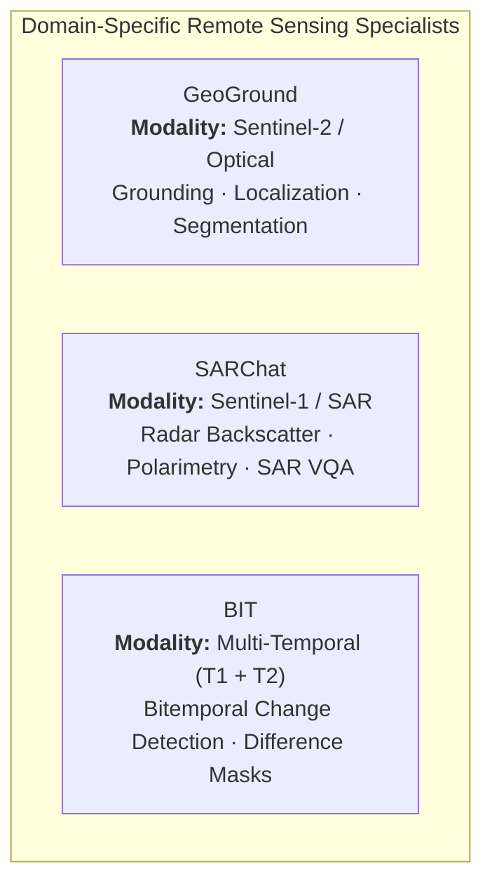
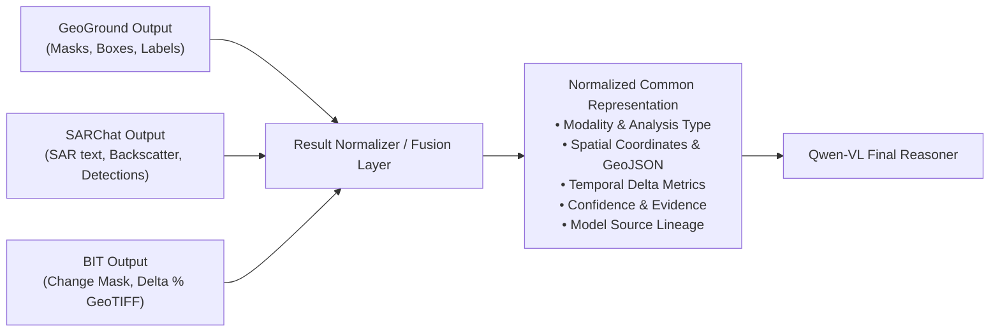
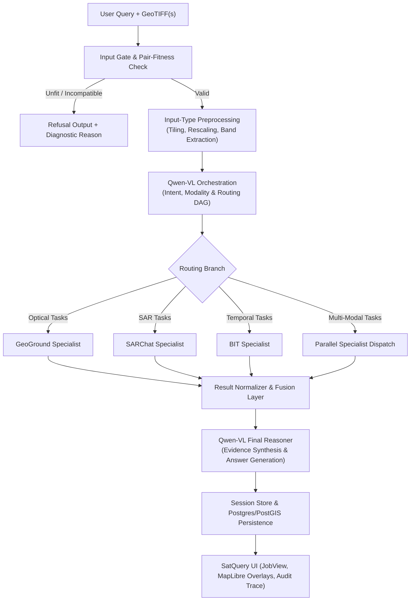

# SatQuery AI — Multimodal Specialist-Agent System Architecture & Technical Design

**Project:** SIH26167 — SatQuery AI  
**Document type:** Master System Architecture & Technical Design  
**Status:** Architecture Baseline — Multimodal Specialist-Agent System  

> **Core Principle:**  
> Qwen-VL acts as the intelligent orchestration and reasoning layer. Specialized remote-sensing models perform domain-specific analysis. Specialist outputs are normalized/fused and passed back to Qwen-VL for final evidence-based reasoning and answer generation.

---

## 1. High-Level System Architecture

SatQuery AI employs a **multimodal specialist-agent architecture** designed specifically for Earth Observation (EO) satellite imagery analysis. It decouples query understanding, sensor-specific visual processing, multi-temporal change detection, and cross-modal synthesis into specialized, high-efficiency stages.

```
                         SATQUERY AI
                              │
                              ▼
                    ┌───────────────────┐
                    │      USER         │
                    │ Natural Language  │
                    │ Query + Optional   │
                    │ AOI / Image / Time│
                    └─────────┬─────────┘
                              │
                              ▼
                    ┌───────────────────┐
                    │  QUERY PROCESSING │
                    │                   │
                    │ Intent            │
                    │ AOI / Location    │
                    │ Temporal context  │
                    │ Sensor / Modality │
                    │ Analysis required │
                    └─────────┬─────────┘
                              │
                              ▼
                    ┌───────────────────┐
                    │      QWEN-VL      │
                    │    ORCHESTRATOR   │
                    │                   │
                    │ Query understanding│
                    │ Task decomposition│
                    │ Specialist routing│
                    │ Workflow planning │
                    └─────────┬─────────┘
                              │
              ┌───────────────┼────────────────┐
              │               │                │
              ▼               ▼                ▼
       ┌─────────────┐ ┌─────────────┐ ┌─────────────┐
       │  GeoGround  │ │   SARChat   │ │     BIT     │
       │     S2      │ │     S1      │ │  Temporal   │
       │             │ │             │ │             │
       │ Grounding   │ │ SAR scene   │ │ Change      │
       │ Localization│ │ understanding│ │ detection  │
       │ Segmentation│ │ SAR reasoning│ │ Temporal   │
       │             │ │             │ │ analysis    │
       └──────┬──────┘ └──────┬──────┘ └──────┬──────┘
              │               │                │
              └───────────────┼────────────────┘
                              ▼
                    ┌────────────────────┐
                    │ RESULT NORMALIZER  │
                    │     / FUSION       │
                    │                    │
                    │ Spatial alignment  │
                    │ Temporal alignment │
                    │ Evidence alignment │
                    │ Confidence/results  │
                    │ Common output      │
                    │ representation     │
                    └─────────┬──────────┘
                              │
                              ▼
                    ┌───────────────────┐
                    │      QWEN-VL      │
                    │   FINAL REASONER  │
                    │                   │
                    │ Evidence synthesis│
                    │ Cross-model       │
                    │ reasoning         │
                    │ Conflict handling │
                    │ Answer generation │
                    └─────────┬─────────┘
                              │
                              ▼
                    ┌───────────────────┐
                    │    SATQUERY UI    │
                    │                   │
                    │ Natural language  │
                    │ answer            │
                    │ Satellite imagery │
                    │ Bounding regions  │
                    │ Segmentation masks│
                    │ Change overlays   │
                    │ SAR visualization │
                    └───────────────────┘
```

---

## 2. Component Responsibilities & Specialist Model Layer

Domain-specific remote-sensing tasks are distributed to dedicated specialist models. Specialists do **not** directly generate final unstructured user answers; they produce structured visual evidence, masks, metrics, and domain-specific observations for subsequent fusion.



### 2.1 GeoGround — Sentinel-2 / Optical Grounding & Segmentation
* **Domain Role:** Dedicated specialist for optical remote-sensing spatial grounding, localization, and segmentation.
* **Modality / Sensors:** Sentinel-2, Cartosat, high-resolution optical imagery.
* **Core Responsibilities:**
  - Object grounding from natural-language phrases (e.g., "storage tanks", "bridges", "runways").
  - Precise object localization with bounding boxes and spatial coordinates.
  - High-fidelity pixel segmentation masks for identified targets.
  - Spatial grounding of spatial references and geographic features.
* **Typical Data Flow:**
  $$\text{Sentinel-2 Optical Image} + \text{User's relevant target/query} \longrightarrow \mathbf{GeoGround} \longrightarrow \text{Grounded regions / masks / bounding coordinates}$$

### 2.2 SARChat — Sentinel-1 / Synthetic Aperture Radar (SAR)
* **Domain Role:** Dedicated specialist for SAR-specific visual reasoning and interpretation.
* **Modality / Sensors:** Sentinel-1 (C-band SAR, VV/VH polarizations), RISAT.
* **Core Responsibilities:**
  - Sentinel-1 SAR scene understanding and speckle-tolerant feature extraction.
  - SAR-specific visual reasoning (dielectric properties, double-bounce scattering, rough surface backscatter).
  - SAR target interpretation (vessels, maritime structures, flood extents, infrastructure under cloud cover).
  - Radar-specific question answering and backscatter anomaly detection.
* **Typical Data Flow:**
  $$\text{Sentinel-1 SAR Image} + \text{Relevant query} \longrightarrow \mathbf{SARChat} \longrightarrow \text{SAR observations / backscatter reasoning / target detections}$$

### 2.3 BIT — Temporal / Bitemporal Change Detection
* **Domain Role:** Dedicated specialist for transformer-based bitemporal change detection.
* **Modality / Sensors:** Multi-temporal paired optical or radar observations across distinct timestamps ($T_1, T_2$).
* **Core Responsibilities:**
  - High-resolution comparison of registered temporal observation pairs.
  - Pixel-level change detection and changed-region binary/semantic segmentation.
  - Temporal difference localization and change area quantification.
* **Typical Data Flow:**
  $$\text{Image } T_1 + \text{Image } T_2 \longrightarrow \mathbf{BIT} \longrightarrow \text{Changed regions / difference masks / change metrics}$$

---

## 3. Qwen-VL Dual-Role Architecture

Qwen-VL serves as the central cognitive engine across two logically distinct stages:

```
┌────────────────────────────────────────────────────────────────────────┐
│                         QWEN-VL COGNITIVE ENGINE                       │
├──────────────────────────────────┬─────────────────────────────────────┤
│      STAGE 1: ORCHESTRATOR       │       STAGE 2: FINAL REASONER       │
├──────────────────────────────────┼─────────────────────────────────────┤
│ • Natural Language Query Parsing │ • Multi-Specialist Evidence Fusion  │
│ • Intent & Modality Extraction   │ • Cross-Modal Spatial-Temporal Logic│
│ • Task Decomposition & Graph DAG │ • Conflict & Uncertainty Resolution │
│ • Dynamic Specialist Routing     │ • Grounded Natural Language Answers │
│ • Workflow Planning & Dispatch   │ • Explanation Tied to GeoJSON/Masks │
└──────────────────────────────────┴─────────────────────────────────────┘
```

### 3.1 Role 1 — Orchestrator & Workflow Planner
In the entry phase, the Orchestrator evaluates the query against metadata and physical raster constraints:
1. **Query & Intent Understanding:** Parses user intent (e.g., counting, status inspection, change identification, spatial search).
2. **Modality & Sensor Determination:** Inspects whether the uploaded assets and query require optical (Sentinel-2), SAR (Sentinel-1), or multi-temporal analysis.
3. **Task Decomposition:** Breaks compound questions into discrete, executable sub-tasks (e.g., "Find new buildings" $\rightarrow$ `BIT` change detection $+$ `GeoGround` building segmentation).
4. **Specialist Routing:** Dispatches subtasks to `GeoGround`, `SARChat`, and/or `BIT` in parallel or sequentially.

### 3.2 Role 2 — Final Reasoner & Evidence Synthesizer
In the exit phase, the Final Reasoner operates over the normalized specialist outputs:
1. **Evidence Synthesis:** Merges raw observations, bounding boxes, masks, and SAR backscatter interpretation into a unified scene model.
2. **Cross-Model Reasoning:** Correlates spatial masks from `GeoGround` with change extents from `BIT` or radar evidence from `SARChat`.
3. **Conflict & Uncertainty Handling:** Resolves conflicting observations (e.g., optical cloud occlusion vs. SAR all-weather verification).
4. **Answer Generation:** Formulates a comprehensive, natural-language explanation grounded strictly in the specialist evidence.

---

## 4. Result Normalization & Fusion Layer

To enable rigorous cross-model reasoning without tight coupling between models, a logical **Result Normalization and Fusion Layer** sits between the specialists and the final Qwen-VL reasoning stage.



### 4.1 Common Output Representation Schema (Conceptual)
Each specialist's raw output is transformed into a standardized, structured dictionary:

```json
{
  "request_id": "REQ-20260911-001",
  "specialist_source": "GeoGround | SARChat | BIT",
  "modality": "OPTICAL_S2 | SAR_S1 | MULTI_TEMPORAL",
  "analysis_type": "GROUNDING | SAR_REASONING | CHANGE_DETECTION",
  "spatial_information": {
    "crs": "EPSG:4326",
    "bounding_boxes": [[77.5946, 12.9716, 77.6046, 12.9816]],
    "mask_artifact_path": "data/jobs/{job_id}/masks/geoground_mask_0.png",
    "geojson_features": []
  },
  "temporal_information": {
    "t1_timestamp": "2022-01-15T10:30:00Z",
    "t2_timestamp": "2026-02-20T10:30:00Z",
    "change_area_sqkm": 0.42
  },
  "observations": "Identified 14 industrial storage tanks in northern quadrant.",
  "confidence": 0.91,
  "evidence_artifacts": ["tiles/tile_0_0_rgb.png", "masks/change_overlay.png"]
}
```

---

## 5. Data & Sensor Relationships

SatQuery AI maintains strict physical and conceptual separation between satellite modalities. Modality isolation guarantees that specialist models operate exclusively within their trained physics and sensor domain:

```
Sentinel-2 (Optical)     ───────►  Optical Workflow   ───────►  GeoGround
Sentinel-1 (SAR / Radar)  ───────►  SAR Workflow       ───────►  SARChat
Multi-Temporal Pairs     ───────►  Temporal Workflow  ───────►  BIT
```

* **Sentinel-2 $\rightarrow$ Optical Workflow $\rightarrow$ GeoGround:** Handles visual spectrum bands (RGB, NIR, SWIR), surface reflectance, optical grounding, and segmentation.
* **Sentinel-1 $\rightarrow$ SAR Workflow $\rightarrow$ SARChat:** Handles radar backscatter intensity (dB), dual-pol ratios (VV/VH), penetration through cloud cover/smoke, and structural dielectric features.
* **Multi-temporal Imagery $\rightarrow$ Temporal Workflow $\rightarrow$ BIT:** Handles spatial-temporal difference grids and change verification across temporal baselines.

> [!IMPORTANT]
> **Modality Boundaries:**
> - `SARChat` does not replace optical visual grounding.
> - `GeoGround` does not process radar backscatter or SAR phase/intensity.
> - `BIT` is not a general-purpose single-image VLM; it computes temporal change differentials.

---

## 6. Query Flow & Multi-Model Workflows

SatQuery AI supports both single-specialist and multi-specialist parallel/sequential execution patterns.

### 6.1 Single-Specialist Workflows

#### Workflow 1: Optical Object Grounding
* **Query:** *"Find all buildings in this region."*
```
Qwen-VL Orchestrator ──► GeoGround ──► Qwen-VL Final Reasoner ──► Grounded Answer + Bounding Polygons / Masks
```

#### Workflow 2: SAR Flood & Scene Analysis
* **Query:** *"Is this region flooded?"*
```
Qwen-VL Orchestrator ──► SARChat ──► Qwen-VL Final Reasoner ──► Grounded Answer + Radar Backscatter Evidence
```

#### Workflow 3: Temporal Change Analysis
* **Query:** *"What changed between 2022 and 2026?"*
```
Qwen-VL Orchestrator ──► BIT ──► Qwen-VL Final Reasoner ──► Grounded Explanation + Change Overlay Mask
```

---

### 6.2 Multi-Specialist Workflows

#### Workflow 4: Multi-Specialist Parallel Execution (Optical Grounding + Temporal Change)
* **Query:** *"What new buildings appeared between 2022 and 2026?"*
* **Execution Pattern:** Parallel specialist dispatch followed by spatial-temporal fusion.

```
                    ┌─────────────────────────┐
                    │  Qwen-VL Orchestrator   │
                    └────────────┬────────────┘
                                 │
                 ┌───────────────┴───────────────┐
                 │                               │
                 ▼                               ▼
          ┌─────────────┐                 ┌─────────────┐
          │  GeoGround  │                 │     BIT     │
          │  Building   │                 │   Change    │
          │ Grounding   │                 │  Detection  │
          └──────┬──────┘                 └──────┬──────┘
                 │                               │
                 └───────────────┬───────────────┘
                                 │
                                 ▼
                    ┌─────────────────────────┐
                    │      Result Fusion      │
                    │ (Spatial Intersection)  │
                    └────────────┬────────────┘
                                 │
                                 ▼
                    ┌─────────────────────────┐
                    │  Qwen-VL Final Reasoner │
                    └────────────┬────────────┘
                                 │
                                 ▼
                    ┌─────────────────────────┐
                    │    Final Explanation    │
                    │ + Highlighted New Bldgs │
                    └─────────────────────────┘
```

#### Workflow 5: Tri-Modal Complex Workflow (Optical + SAR + Temporal)
* **Query:** *"Assess all-weather structural damage and land cover change following the flood event."*
* **Execution Pattern:** Parallel routing to `GeoGround` (optical features), `SARChat` (flood water extent & infrastructure radar backscatter), and `BIT` (pre/post change detection), followed by cross-model synthesis.

```
                       ┌─────────────────────────┐
                       │  Qwen-VL Orchestrator   │
                       └────────────┬────────────┘
                                    │
           ┌────────────────────────┼────────────────────────┐
           │                        │                        │
           ▼                        ▼                        ▼
    ┌─────────────┐          ┌─────────────┐          ┌─────────────┐
    │  GeoGround  │          │   SARChat   │          │     BIT     │
    │ (Structures)│          │ (SAR Flood) │          │  (Changes)  │
    └──────┬──────┘          └──────┬──────┘          └──────┬──────┘
           │                        │                        │
           └────────────────────────┼────────────────────────┘
                                    │
                                    ▼
                       ┌─────────────────────────┐
                       │ Result Normalizer/Fusion│
                       └────────────┬────────────┘
                                    │
                                    ▼
                       ┌─────────────────────────┐
                       │  Qwen-VL Final Reasoner │
                       └────────────┬────────────┘
                                    │
                                    ▼
                       ┌─────────────────────────┐
                       │    Comprehensive        │
                       │ Grounded Multi-Evidence │
                       │         Report          │
                       └─────────────────────────┘
```

---

## 7. Operational Workflow & Execution Pipeline



---

## 8. State & Session Memory Architecture

SatQuery AI manages runtime state through a two-tiered memory hierarchy:

```
┌────────────────────────────────────────────────────────────────────────┐
│                   IN-MEMORY LIVE SESSION (FastAPI)                     │
│                  sessions[session_id] = SessionContext                 │
│                                                                        │
│ • Active job state & parameters                                        │
│ • Preprocessed tile coordinates & intermediate masks                   │
│ • Specialist normalized tool results                                   │
│ • Evidence artifacts currently in-flight                               │
└──────────────────────────────────┬─────────────────────────────────────┘
                                   │ On graph completion / refusal
                                   ▼
┌────────────────────────────────────────────────────────────────────────┐
│                   PERSISTENT STORAGE (Postgres + Disk)                 │
│                                                                        │
│ • PostgreSQL: Structured jobs, audit traces, logs, execution receipts  │
│ • PostGIS: Vector boundaries, footprints, change MULTIPOLYGONs         │
│ • Filesystem (data/jobs/{id}/): Rasters, tiles, masks, reports, PDF    │
└────────────────────────────────────────────────────────────────────────┘
```

* **No external distributed queue in base runtime:** In-memory execution using native asyncio/FastAPI background tasks eliminates Redis/Kafka operational complexity for edge and isolated deployments.
* **Deterministic Persistence:** State is written to relational and spatial storage at pipeline termination (`END`, `REFUSE`, or `FAIL`).

---

## 9. Gate, Modality & Pair-Fitness Subsystem

Before model invocation, a deterministic validator verifies the geometric and physical integrity of the inputs:

| Check | Condition | Action on Failure |
|---|---|---|
| **CRS & Projections** | Identical or reprojection supported | Re-project or Refuse |
| **Spatial Overlap** | Pair intersection $\ge 10\%$ IoU | `REFUSE: Insufficient spatial overlap` |
| **Temporal Consistency** | Timestamp metadata present and distinct | `REFUSE: Missing or identical timestamps` |
| **Cloud Cover Fraction** | Optical quality above threshold | Warn and route / supplement with SAR |
| **Radiometric Bounds** | Band count and bit depth verified | Normalized via `PercentileMinMax` |

---

## 10. SatQuery UI & Output Synthesis

The client receives a unified, immutable **`JobView`** response containing:
1. **Natural Language Answer:** Final evidence-grounded response synthesized by Qwen-VL.
2. **Interactive Map Overlays:** MapLibre-rendered vector layers (GeoJSON bounding polygons, segmentation boundaries).
3. **Raster Artifacts:** High-resolution change detection masks (BIT), SAR backscatter composites, and optical RGB overlays.
4. **Audit Trace & Lineage:** Transparent breakdown of which specialist models fired, execution latencies, confidence metrics, and parameter settings.

---

## 11. Architectural Constraints & Decision Register

| ID | Architectural Constraint | Status | Justification |
|---|---|---|---|
| **C1** | **MobileSAM Removal** | **Removed** | Replaced by `GeoGround`, which natively handles remote-sensing grounding and segmentation without an external SAM stage. |
| **C2** | **Qwen-VL Dual Role** | **Active** | Logical separation between Orchestration (routing/decomposition) and Final Reasoning (synthesis/answer generation). |
| **C3** | **Specialist Modality Separation** | **Locked** | Optical $\rightarrow$ GeoGround, SAR $\rightarrow$ SARChat, Temporal $\rightarrow$ BIT. No cross-modality contamination. |
| **C4** | **Normalized Fusion Intermediate** | **Required** | Decouples specialist model internals from Qwen-VL prompt conditioning. |
| **C5** | **No Direct Specialist Output** | **Locked** | Specialist models never output final user-facing text independently; all results pass through Qwen-VL reasoning. |
| **C6** | **No Heavy Distributed Queues** | **Preserved** | FastAPI in-memory session store + Postgres persistence. No Redis/Celery/Kafka dependencies. |
| **C7** | **Deterministic Graph Routing** | **Preserved** | LangGraph DAG with validated conditional routing rather than unbounded tool creation. |
| **C8** | **Integration Reality** | **Locked** | Documentation reflects the architectural specification without falsely claiming unbuilt backend code implementations. |
