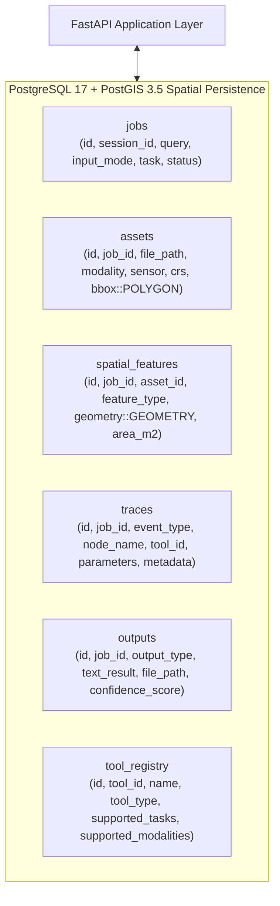
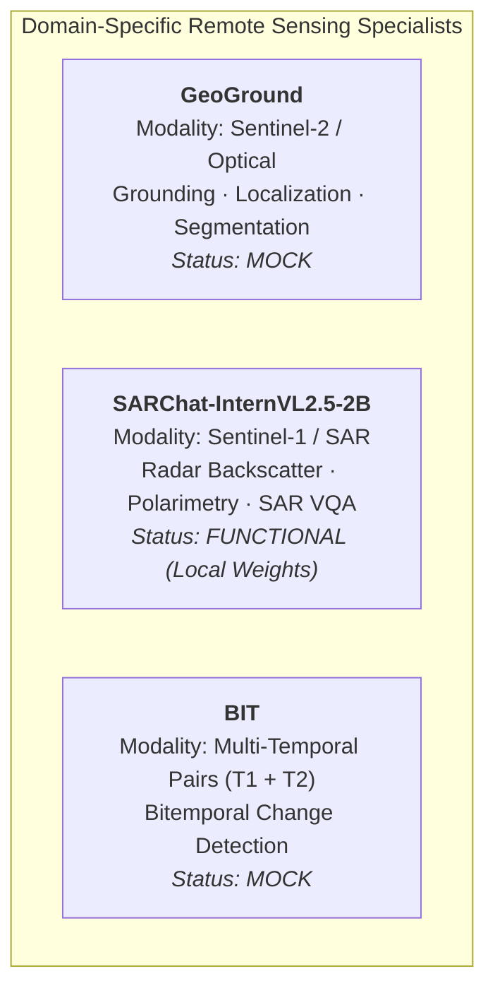
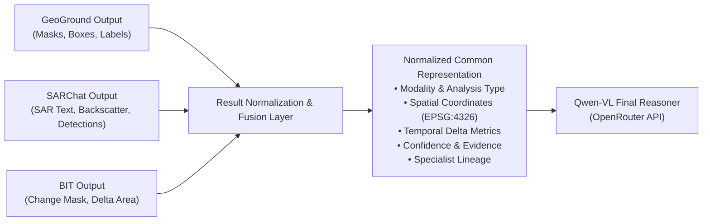

# SatQuery AI — Complete System Architecture & Technical Design

**Project:** SIH26167 — SatQuery AI  
**Document Type:** Master System Architecture & Technical Specification  
**System Classification:** Natural-Language Remote-Sensing Intelligence System  
**Status:** Authoritative Architecture Reference (Current Baseline vs. Target State)  

> **Core Architectural Principle:**  
> SatQuery AI is a natural-language remote-sensing intelligence platform combining **PostGIS** spatial data persistence, a **Vision-Language Model (VLM)** (active implementation: **Google Gemma 4 31B Free** via OpenRouter) for multimodal orchestration and final evidence synthesis, and domain-specific specialist vision models (**GeoGround**, **SARChat**, and **BIT**) across optical, radar (SAR), and temporal satellite modalities.

---

## 1. System Vision & Architectural Classification

SatQuery AI is **not** merely a chatbot, a raster viewer, or an isolated image classifier. It is a unified **Natural-Language Remote-Sensing Intelligence System** that fuses:
* **Natural-Language Intent Understanding:** Parsing complex analyst queries, extracting spatial AOIs, temporal bounds, and analytical goals.
* **First-Class Spatial Data Persistence (PostGIS):** Managing spatial footprints, geographic bounding boxes, multi-temporal metadata, and vector evidence layers.
* **Modality-Specific Satellite Preprocessing:** Radiometric calibration, dB scaling, speckle reduction, percentile contrast stretching, and synchronized bitemporal grid alignment.
* **Specialist Remote-Sensing AI Models:** Domain-tailored vision models for optical grounding (**GeoGround**), synthetic aperture radar interpretation (**SARChat**), and bitemporal change detection (**BIT**).
* **Multimodal Orchestration & Cross-Model Reasoning (VLM via OpenRouter — active: Google Gemma 4 31B Free):** Intelligent task decomposition and final multi-evidence reasoning.
* **Interactive Geospatial Visualization:** High-performance MapLibre GL map views, raster composites, detection overlays, and audit lineage traces.

---

## 2. Master System Architecture Diagram (Target State)

The diagram below illustrates the target end-to-end architecture.

```
                         SATQUERY AI
                              │
                              ▼
                    ┌───────────────────┐
                    │USER / SATQUERY UI │
                    │ React 19 / Vite   │
                    │ MapLibre Evidence │
                    └─────────┬─────────┘
                              │ HTTPS / JSON / Multipart
                              ▼
                    ┌───────────────────┐
                    │  FASTAPI BACKEND  │
                    │  API & App Logic  │
                    └─────────┬─────────┘
                              │
             ┌────────────────┴────────────────┐
             │                                 │
             ▼                                 ▼
   ┌───────────────────┐             ┌───────────────────┐
   │ QUERY PROCESSING  │             │      POSTGIS      │
   │ Intent & Context  │◄───────────►│Spatial Data Layer │
   │ Spatial / Temporal│             │Footprints, Bounds,│
   │ Parameter Parser  │             │Assets, Traces, SF │
   └─────────┬─────────┘             └─────────┬─────────┘
             │                                 │
             └────────────────┬────────────────┘
                              │ Context + Imagery Metadata
                              ▼
                    ┌───────────────────┐
                    │  VLM API LAYER    │  [IMPLEMENTED: OpenRouter]
                    │   (ORCHESTRATOR)  │  Configured via VLM_MODEL
                    │                   │  (Default: .env free model)
                    │ Task Decomposition│
                    │ Sensor Routing    │
                    │ Workflow Planning │
                    └─────────┬─────────┘
                              │ Dispatch Subtasks
              ┌───────────────┼────────────────┐
              │               │                │
              ▼               ▼                ▼
       ┌─────────────┐ ┌─────────────┐ ┌─────────────┐
       │  GeoGround  │ │   SARChat   │ │     BIT     │
       │ Sentinel-2  │ │ Sentinel-1  │ │  Temporal   │
       │   Optical   │ │     SAR     │ │   Change    │
       │             │ │             │ │             │
       │ Grounding   │ │ Scene VQA   │ │ Difference  │
       │ Localization│ │ Backscatter │ │ Detection   │
       │ Segmentation│ │ Interpretation│  Change Mask │
       │ [MOCK]      │ │ [FUNCTIONAL]│ │ [MOCK]      │
       └──────┬──────┘ └──────┬──────┘ └──────┬──────┘
              │               │                │
              └───────────────┼────────────────┘
                              │ Raw Specialist Evidence
                              ▼
                    ┌────────────────────┐  [PLANNED]
                    │ RESULT NORMALIZER  │
                    │     / FUSION       │
                    │                    │
                    │ Spatial Alignment  │
                    │ Temporal Alignment │
                    │ Confidence & Provenance
                    │ Normalized Schema  │
                    └─────────┬──────────┘
                              │ Unified Evidence Structure
                              ▼
                    ┌───────────────────┐  [IMPLEMENTED: OpenRouter]
                    │  VLM API LAYER    │  Configured via VLM_MODEL
                    │  (FINAL REASONER) │  (Default: .env free model)
                    │                   │
                    │ Cross-Modal Logic │
                    │ Conflict Handling │
                    │ Grounded Synthesis│
                    └─────────┬─────────┘
                              │ Final Grounded Answer + Evidence
             ┌────────────────┴────────────────┐
             │                                 │
             ▼                                 ▼
   ┌───────────────────┐             ┌───────────────────┐
   │ POSTGIS / STORAGE │             │    SATQUERY UI    │
   │ Completed Jobs,   │             │ Natural Language  │
   │ Traces, Outputs,  │             │ MapLibre Overlays │
   │ Vector Polygons   │             │ Multi-Channel SAR │
   └───────────────────┘             └───────────────────┘
```

> [!IMPORTANT]
> **Data Access Rule:** AI models **never** connect directly to PostGIS. All database queries, spatial transactions, and asset metadata operations are strictly mediated by the FastAPI backend data-access layer.

---

## 3. PostGIS as a Core Architectural Component

PostGIS is a **first-class, foundational component** of SatQuery AI, not an implementation detail or an interchangeable database. Satellite intelligence requires rigorous coordinate reference system (CRS) projections, topological intersections, and persistent vector tracking.



### 3.1 PostGIS Responsibilities in SatQuery AI:
1. **Raster Footprint Storage:** Ingested raster boundaries are stored as WGS84 bounding polygons (`assets.bbox` as `Geometry(POLYGON, 4326)`).
2. **Spatial Overlap & IoU Calculation:** Evaluates spatial intersections between bitemporal or optical-SAR raster pairs before invoking compute-heavy models.
3. **Vector Feature Persistence:** Stores model-generated outputs such as grounding bounding boxes, building footprints, flood extents, and change polygons (`spatial_features.geometry`).
4. **Audit Trail & Observability:** Records structured JSON traces and tool run receipts for every execution node (`traces` and `tool_runs`).
5. **No Rasters in DB:** PostGIS stores vector geometries and metadata. Raw rasters, composites, tiles, and masks reside strictly on disk (`data/jobs/{job_id}/`).

---

## 4. End-to-End System Data Flow

The complete data lifecycle follows a strict pipeline from user ingestion to persistent visualization:

```
USER
  │ Natural Language Query + Satellite GeoTIFF(s) / AOI
  ▼
QUERY PROCESSING
  │ Input Validation, Modality Inspection & Intent Classification
  ▼
GEOSPATIAL & TEMPORAL DATA RETRIEVAL
  │ Header Metadata Parsing, CRS Verification, Spatial Overlap (IoU) Check
  ▼
POSTGIS + SATELLITE PREPROCESSING
  │ Footprints Persisted to PostGIS; Rasters Sliced into Normalized Model Tiles
  ▼
QWEN-VL ORCHESTRATION [PLANNED: OpenRouter API]
  │ Query Understanding, Subtask Decomposition, Specialist Routing DAG
  ▼
SPECIALIST MODEL EXECUTION
  │ GeoGround (Optical) | SARChat (SAR) | BIT (Temporal Change)
  ▼
RESULT NORMALIZATION / FUSION [PLANNED]
  │ Heterogeneous Outputs Standardized into Unified Spatial-Temporal Schema
  ▼
QWEN-VL FINAL REASONING [PLANNED: OpenRouter API]
  │ Cross-Modal Synthesis, Anomaly Resolution, Grounded Natural Language Answer
  ▼
POSTGIS / RESULT PERSISTENCE
  │ Final Text, Vector Polygons, and Lineage Saved to PostgreSQL/PostGIS
  ▼
SATQUERY UI
  │ MapLibre GL Visualization, Raster Toggles, GeoJSON/KML/PDF Exports
```

---

## 5. Vision-Language Model (VLM) Architecture & Hosting Model

### 5.1 Dual-Role Logical Engine
The Vision-Language Model (VLM) operates across two logically distinct stages:

```
┌────────────────────────────────────────────────────────────────────────┐
│                     VLM COGNITIVE ARCHITECTURE                         │
├──────────────────────────────────┬─────────────────────────────────────┤
│      STAGE 1: ORCHESTRATOR       │       STAGE 2: FINAL REASONER       │
├──────────────────────────────────┼─────────────────────────────────────┤
│ • Natural Language Query Parsing │ • Multi-Specialist Evidence Fusion  │
│ • Intent & Modality Extraction   │ • Cross-Modal Spatial-Temporal Logic│
│ • Task Decomposition & Graph DAG │ • Conflict & Uncertainty Resolution │
│ • Dynamic Specialist Routing     │ • Grounded Natural Language Answers │
│ • Workflow Planning & Dispatch   │ • Explanation Tied to GeoJSON/Masks │
└──────────────────────────────────┴─────────────────────────────────────┘
```

* **Role 1 — Orchestrator (Entry Phase):**
  - Evaluates user query and image metadata.
  - Determines required sensor modalities (Sentinel-1 SAR, Sentinel-2 Optical, or Multi-Temporal).
  - Decomposes multi-intent queries (e.g., *"Find new buildings after the flood"* $\rightarrow$ SAR flood extent $+$ BIT change $+$ GeoGround building segmentation).
* **Role 2 — Final Reasoner (Exit Phase):**
  - Receives normalized specialist outputs.
  - Resolves cross-modal discrepancies (e.g., optical cloud obscuration resolved by all-weather SAR backscatter).
  - Generates final user-facing text explanations strictly citing spatial evidence.

### 5.2 Hosting Model: OpenRouter API Layer (Active: Google Gemma 4 31B Free)
To prevent massive VRAM exhaustion on edge or local servers, the VLM is **hosted externally and accessed via OpenRouter**, not hosted locally within the Python process.

```
┌─────────────────┐       HTTPS       ┌─────────────────┐       HTTPS       ┌─────────────────┐
│ React Frontend  │ ────────────────► │ SatQuery Backend│ ────────────────► │ OpenRouter API  │
│ (User Interface)│                   │(Server-Side API)│ (Secured Bearer)  │(Gemma 4 31B Free)
└─────────────────┘                   └─────────────────┘                   └─────────────────┘
```

> [!CAUTION]
> **Security Boundary:** The OpenRouter API key is a **strict server-side secret**. The React frontend never connects directly to OpenRouter; all LLM requests are proxied and authenticated by the FastAPI backend.

* **Active Implementation Status:** **IMPLEMENTED & FUNCTIONAL.** (Configured via `VLM_MODEL` in `.env`, e.g. `google/gemma-4-31b-it:free` over OpenRouter).

---

## 6. Specialist Model Layer & Sensor Separation

Satellite intelligence requires models trained on the specific physics of each sensor. Specialist models perform domain-specific vision tasks and output structured artifacts rather than raw conversational answers.



### 6.1 GeoGround — Sentinel-2 / Optical Grounding & Segmentation
* **Modality / Sensors:** Sentinel-2, Cartosat, high-resolution optical imagery.
* **Responsibilities:** Object grounding from natural-language phrases, spatial coordinate localization, pixel segmentation masks.
* **Data Flow:**
  $$\text{Sentinel-2 Optical Image} + \text{Query Target} \longrightarrow \mathbf{GeoGround} \longrightarrow \text{Bounding Polygons / Segmentation Masks}$$
* **Current Implementation Status:** **MOCK / NOT FUNCTIONALLY INTEGRATED.** (Represented by `MockGrounding` returning static bounding box coordinates).

### 6.2 SARChat-InternVL2.5-2B — Sentinel-1 / Synthetic Aperture Radar (SAR)
* **Modality / Sensors:** Sentinel-1 (C-Band SAR, VV/VH polarizations), RISAT.
* **Responsibilities:** Radar backscatter analysis (dielectric properties, double-bounce scattering, rough surface volume scattering), flood detection, all-weather scene interpretation, SAR VQA.
* **Data Flow:**
  $$\text{Sentinel-1 SAR Image (VV/VH)} + \text{Query} \longrightarrow \mathbf{SARChat} \longrightarrow \text{SAR Observations / Detection Tokens / dB Stats}$$
* **Current Implementation Status:** **FUNCTIONAL & INTEGRATED (LOCAL WEIGHTS).** (`SARChatService` loads `JimmyMa99/SARChat-InternVL2.5-2B` locally; integrated with GIS raster backscatter calibration in `sar_analyzer.py`).

### 6.3 BIT — Temporal / Bitemporal Change Detection
* **Modality / Sensors:** Multi-temporal paired optical or radar observations ($T_1, T_2$).
* **Responsibilities:** Bitemporal image comparison, pixel-level change detection probability maps, changed-area delta calculations.
* **Data Flow:**
  $$\text{Image } T_1 + \text{Image } T_2 \longrightarrow \mathbf{BIT} \longrightarrow \text{Change Probability Masks / Delta Metrics}$$
* **Current Implementation Status:** **MOCK / NOT FUNCTIONALLY INTEGRATED.** (Represented by `MockBitCD` returning `"MOCK_BIT_CD_MASK"`; research code exists in `models/BIT.ipynb`).

---

## 7. Deprecation & Removal of MobileSAM

* **Architectural Decision:** **MobileSAM is REMOVED from the active and target SatQuery AI architecture.**
* **Rationale:** `GeoGround` natively handles end-to-end natural-language grounding and spatial segmentation for Earth observation rasters, eliminating the need for an external SAM prompt-engineering pipeline.
* **Current Codebase State:** Deprecated references in `mock_tools.py`, `tool_catalog.py`, `model_slotting.py`, and `schemas.py` are slated for removal during code cleanup.

---

## 8. Result Normalization & Fusion Layer (Conceptual Design)

To enable seamless multi-model reasoning without tightly coupling specialist architectures, a logical **Result Normalization and Fusion Layer** converts heterogeneous outputs into a standardized dictionary:



### 8.1 Common Output Representation Schema (Target Definition):
```json
{
  "request_id": "REQ-20260911-001",
  "specialist_source": "GeoGround | SARChat | BIT",
  "modality": "OPTICAL_S2 | SAR_S1 | MULTI_TEMPORAL",
  "analysis_type": "GROUNDING | SAR_REASONING | CHANGE_DETECTION",
  "spatial_information": {
    "crs": "EPSG:4326",
    "bounding_boxes": [[72.042, 22.781, 72.158, 22.879]],
    "mask_artifact_path": "data/jobs/{job_id}/masks/mask_0.png",
    "geojson_features": []
  },
  "temporal_information": {
    "t1_timestamp": "2022-03-08T10:30:00Z",
    "t2_timestamp": "2024-02-21T10:30:00Z",
    "change_area_sqkm": 0.42
  },
  "observations": "Identified 14 industrial storage tanks in northern quadrant.",
  "confidence": 0.91,
  "evidence_artifacts": ["tiles/tile_0_0_rgb.png", "masks/change_overlay.png"]
}
```
* **Current Implementation Status:** **PLANNED / NOT YET IMPLEMENTED.**

---

## 9. Example End-to-End Query Workflows (Target Architecture)

```
┌────────────────────────────────────────────────────────────────────────┐
│                   TARGET MULTI-SPECIALIST WORKFLOWS                    │
└────────────────────────────────────────────────────────────────────────┘
```

### Example 1: Optical Object Grounding (Single Specialist)
* **User Query:** *"Find all buildings in this region."*
```
User Query ──► Qwen-VL (OpenRouter) ──► GeoGround ──► Normalized Result ──► Qwen-VL (OpenRouter) ──► Answer + Bounding Polygons
```

### Example 2: SAR Flood Analysis (Single Specialist)
* **User Query:** *"Is this region flooded?"*
```
User Query ──► Qwen-VL (OpenRouter) ──► SARChat ──► Normalized SAR Evidence ──► Qwen-VL (OpenRouter) ──► Answer + Radar Backscatter Proof
```

### Example 3: Temporal Land-Cover Change (Single Specialist)
* **User Query:** *"What changed between 2022 and 2026?"*
```
User Query ──► Qwen-VL (OpenRouter) ──► BIT ──► Normalized Change Delta ──► Qwen-VL (OpenRouter) ──► Answer + Change Difference Overlay
```

### Example 4: Multi-Specialist Parallel Execution (Optical Grounding + Temporal Change)
* **User Query:** *"What new buildings appeared between 2022 and 2026?"*
```
                         User Query
                             │
                             ▼
                 Qwen-VL Orchestrator (OpenRouter)
                             │
             ┌───────────────┴───────────────┐
             ▼                               ▼
         GeoGround                          BIT
    (Building Detection)             (Change Detection)
             │                               │
             └───────────────┬───────────────┘
                             ▼
                Result Normalization & Fusion
                  (Spatial Intersection)
                             │
                             ▼
                 Qwen-VL Final Reasoner (OpenRouter)
                             │
                             ▼
             Answer + Highlighted New Buildings Map
```

---

## 10. Satellite Data Ingestion & Preprocessing Pipelines

```
Sentinel-2 (Optical)  ──► Ingestion ──► OpticalPreprocessor  ──► GeoGround [MOCK]
Sentinel-1 (SAR)      ──► Ingestion ──► SARPreprocessor      ──► SARChat [FUNCTIONAL]
Multi-Temporal Pairs  ──► Ingestion ──► BitemporalPreprocessor ──► BIT [MOCK]
```

### 10.1 Optical Preprocessing Pipeline (`OpticalPreprocessor`):
- Reads red, green, blue bands (or duplicates panchromatic bands to 3 channels).
- Applies `PercentileMinMax` $[2\%, 98\%]$ radiometric contrast stretch.
- Produces full-scene preview composite and georeferenced $256 \times 256$ tiles.

### 10.2 SAR Preprocessing Pipeline (`SARPreprocessor`):
- Radiometric calibration of raw intensity to decibel scale: $\text{dB} = 10 \cdot \log_{10}(\text{clip}(\text{DN}, 10^{-5}, \infty))$.
- Computes dual-pol ratio composite: Red = VV, Green = VH, Blue = VV / (VH + 0.1).
- Generates VV, VH, and overlay visual products.

### 10.3 Bitemporal Preprocessing Pipeline (`BitemporalPreprocessor`):
- Validates minimum spatial overlap ($\text{IoU} \ge 10\%$).
- Crops rasters to their shared geographic intersection bounding box.
- Slices synchronized, geographically paired tiles for $T_1$ and $T_2$.

---

## 11. Backend, Memory & Persistence Architecture

The backend application uses a decoupled two-tiered memory architecture:

```
┌────────────────────────────────────────────────────────────────────────┐
│                   IN-MEMORY LIVE SESSION (FastAPI)                     │
│                  sessions[session_id] = SessionContext                 │
│                                                                        │
│ • In-flight job state & active parameters                              │
│ • Preprocessed tile filepaths & intermediate raster references         │
│ • Raw specialist tool results in execution                             │
└──────────────────────────────────┬─────────────────────────────────────┘
                                   │ On graph completion / refusal
                                   ▼
┌────────────────────────────────────────────────────────────────────────┐
│              PERSISTENT DATA LAYER (PostgreSQL + PostGIS)              │
│                                                                        │
│ • PostgreSQL: Structured jobs, traces, outputs, tool runs              │
│ • PostGIS: Vector boundaries, footprints, spatial features             │
│ • Filesystem (data/jobs/{id}/): Rasters, tiles, masks, reports, PDF    │
└────────────────────────────────────────────────────────────────────────┘
```

* **API Endpoints:**
  - `POST /ingest` — Uploads GeoTIFFs, performs metadata extraction & PostGIS asset persistence.
  - `POST /run` — Launches LangGraph workflow in background tasks.
  - `GET /jobs/{job_id}` — Returns the unified immutable `JobView` document.
  - `GET /jobs/{job_id}/artifacts/*` — Fetches composite, VV, VH, and overlay rasters.
  - `GET /jobs/{job_id}/export.*` — Exports GeoJSON footprints, KML, and ReportLab PDF reports.

---

## 12. Frontend & MapLibre Visualization

* **Framework:** React 19 + TypeScript 5.9 + Vite 8 + Tailwind CSS 4.
* **Geospatial Map Engine:** **MapLibre GL 5** (`MapEvidence.tsx`).
* **Visual Capabilities:**
  - Live background layer switching between OpenStreetMap basemap, Optical composite, and SAR multi-channel rasters.
  - Dynamic GeoJSON vector rendering for bounding boxes, spatial grounding regions, and change masks.
  - Wipe swipe-slider for interactive visual comparison of $T_1$ vs. $T_2$ bitemporal scenes.
  - Execution audit timeline rendering every step in the agentic trace.

---

## 13. Current Implemented Architecture vs. Target Architecture

| Component / Subsystem | Current Codebase Implementation | Target / Intended Architecture | Implementation Status |
|---|---|---|---|
| **User Interface** | React 19 + MapLibre GL console | React 19 + MapLibre GL console | **Implemented & Functional** |
| **Backend API** | FastAPI asynchronous endpoints | FastAPI asynchronous endpoints | **Implemented & Functional** |
| **Spatial Database** | PostgreSQL 17 + PostGIS 3.5 | PostgreSQL 17 + PostGIS 3.5 | **Implemented & Functional** |
| **Live State Store** | In-memory `SessionContext` dictionary | In-memory `SessionContext` dictionary | **Implemented & Functional** |
| **Raster Ingestion & Gate** | Deterministic 4-class `InputClassifier` | Deterministic 4-class `InputClassifier` | **Implemented & Functional** |
| **S1 / S2 Preprocessing** | Modality-specific tile slicing & scaling | Modality-specific tile slicing & scaling | **Implemented & Functional** |
| **SAR Specialist** | `SARChat-InternVL2.5-2B` (Local PyTorch) | `SARChat-InternVL2.5-2B` (Local PyTorch) | **Implemented & Functional** |
| **Optical Specialist** | `MockGrounding` (Static mock boxes) | `GeoGround` model integration | **Mock / Planned** |
| **Temporal Specialist** | `MockBitCD` (Static mock mask) | `BIT` model integration | **Mock / Planned** |
| **MobileSAM** | Deprecated mock classes in codebase | **Completely removed** (Replaced by GeoGround) | **Deprecated / In Codebase** |
| **Orchestrator** | Text-only Ollama Qwen-3B / Regex fallback | Multimodal Qwen-VL via OpenRouter API | **Planned** |
| **Workflow Routing** | Single-path mutually exclusive LangGraph | Multi-specialist parallel fan-out LangGraph | **Planned** |
| **Result Normalization** | Raw tool results placed in state | Standardized common representation schema | **Planned** |
| **Final Reasoner** | Static string formatter in report generator | Multimodal Qwen-VL via OpenRouter API | **Planned** |

---

## 14. Security Architecture

1. **Server-Side API Key Management:** OpenRouter API keys, database credentials, and internal secrets must remain strictly on the backend and loaded via `.env`.
2. **No Frontend Credential Leakage:** The React client never receives or stores external AI service keys.
3. **Untrusted Input Handling:** User queries, uploaded GeoTIFF headers, and filenames are treated as untrusted input and sanitized via `_safe_filename` and raster validation.
4. **Backend-Mediated Database Access:** Direct SQL execution from AI models or client requests is forbidden; all PostGIS interactions pass through parameterized SQLAlchemy ORM queries.
5. **Audit Logging Hygiene:** Database connection passwords and third-party API bearer tokens are scrubbed and never recorded in the `traces` or `logs` tables.

---

## 15. Deployment Architecture

* **Development Environment:**
  - Local Python 3.12/3.13 virtual environment (`uv` / `venv`).
  - PostgreSQL + PostGIS running locally or in standalone Docker container.
  - Local PyTorch runtime for `SARChat-InternVL2.5-2B` (utilizing Apple Silicon MPS or CUDA).
  - OpenRouter API accessed via outbound HTTPS for Qwen-VL.
* **Production Deployment (Target):**
  - Multi-stage containerized build (`Dockerfile` + `docker-compose.yml`).
  - Gunicorn / Uvicorn multi-worker FastAPI backend.
  - Dedicated PostgreSQL/PostGIS database container with persistent volume storage.
  - Nginx reverse proxy serving compiled static Vite assets and routing `/api/` traffic.

---

## 16. Authoritative Architectural Principles

1. **PostGIS-First Spatial Architecture:** PostGIS is the authoritative source for all geospatial relationships, bounds, footprints, and persistent spatial features.
2. **Natural-Language-First Interface:** Translates non-expert analyst questions into rigorous remote-sensing workflows.
3. **Specialist Modality Separation:** Optical (Sentinel-2), radar (Sentinel-1), and temporal change tasks are handled by dedicated models tailored to their sensor physics.
4. **Qwen-VL via OpenRouter:** General multimodal visual orchestration and final evidence synthesis are powered by Qwen-VL hosted via the OpenRouter API.
5. **Backend-Mediated AI Access:** AI models operate through standard backend service adapters; external APIs are secured server-side.
6. **Compound Multi-Specialist Workflows:** Complex questions trigger parallel specialist execution (e.g., GeoGround + BIT).
7. **Evidence-Grounded Explanations:** Final answers must directly cite and align with spatial polygons, masks, and backscatter statistics.
8. **Clear Implementation vs. Target Boundaries:** Documentation transparently delineates active functional code from planned capabilities.
9. **Preservation of Functional Baseline:** Protects and leverages working S1/S2 preprocessing, PostGIS persistence, and the functional SARChat specialist.
10. **Zero Model Redundancy:** Replaces multi-model overlap with dedicated specialists (e.g., MobileSAM removed in favor of GeoGround).
