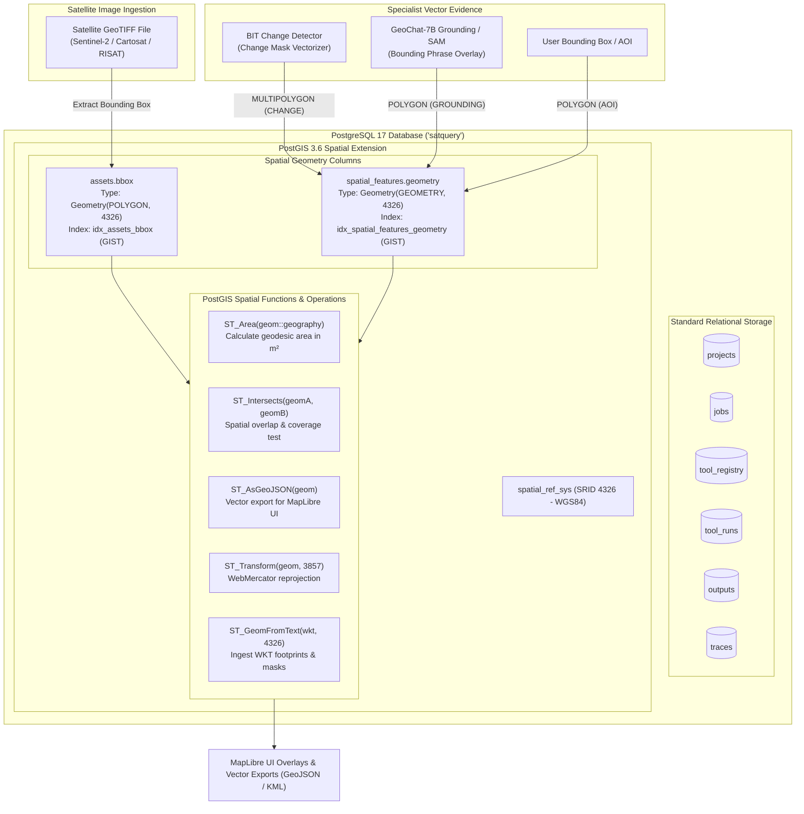
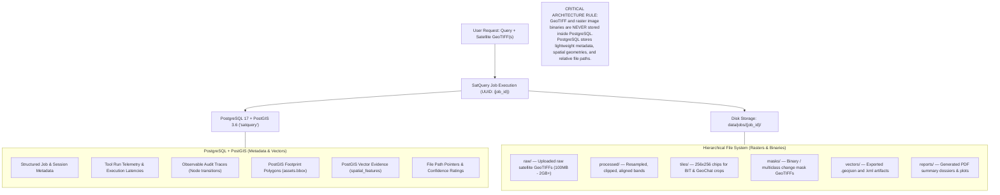
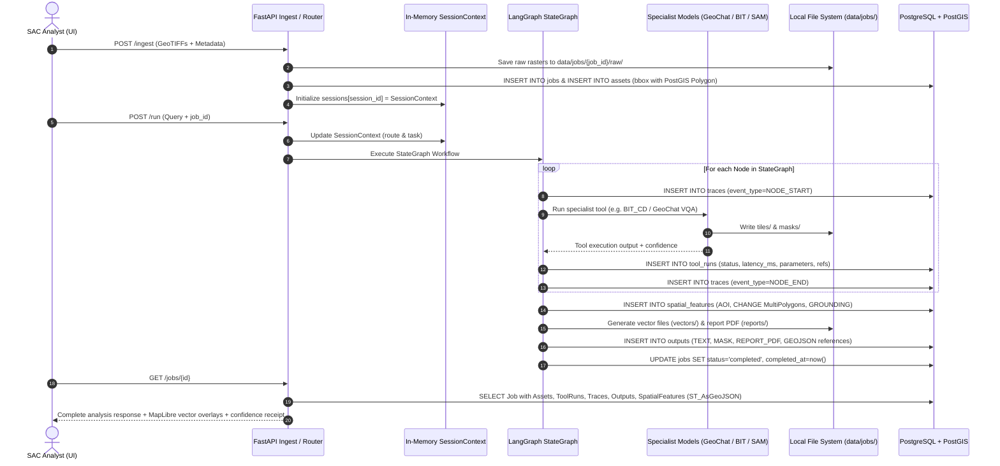

# SatQuery AI — Database Architecture & Spatial Data Model

**Project:** SIH26167 — SatQuery AI  
**Document Type:** Database Architecture & Entity-Relationship Reference  
**Status:** Implementation Baseline — PostgreSQL 17.10 + PostGIS 3.6  
**Implementation Source:** [`backend/models.py`](file:///Users/dhanyahariya/Downloads/satnav/backend/models.py) & [`migrations/versions/0b8f65db36fc_initial_satquery_schema.py`](file:///Users/dhanyahariya/Downloads/satnav/migrations/versions/0b8f65db36fc_initial_satquery_schema.py)

---

## 1. Executive Summary

SatQuery AI employs a dual-tier persistence model:
1. **Relational & Spatial Database (PostgreSQL 17 + PostGIS 3.6)**: Manages metadata, job states, tool registries, execution traces, generated output manifests, and vector evidence (polygons, footprints, and change masks).
2. **On-Disk Hierarchical Storage (`data/jobs/{job_id}/...`)**: Retains multi-gigabyte satellite rasters (GeoTIFFs), cropped tiles, binary change masks, vector files, and PDF reports.

> [!IMPORTANT]
> **Zero Multi-GB Rasters in Database**: Satellite imagery binary payloads remain strictly on disk. PostgreSQL stores file paths, bounding footprints, sensor metadata, and vector evidence.

---

## 2. Visual Architecture Diagrams

### A. PostgreSQL Entity-Relationship (ER) Diagram

```mermaid
erDiagram
    PROJECTS ||--o{ JOBS : "contains (1:N, ON DELETE SET NULL)"
    JOBS ||--o{ ASSETS : "owns (1:N, ON DELETE CASCADE)"
    JOBS ||--o{ TOOL_RUNS : "executes (1:N, ON DELETE CASCADE)"
    TOOL_REGISTRY ||--o{ TOOL_RUNS : "defines (1:N, ON DELETE RESTRICT)"
    JOBS ||--o{ OUTPUTS : "yields (1:N, ON DELETE CASCADE)"
    JOBS ||--o{ TRACES : "logs (1:N, ON DELETE CASCADE)"
    JOBS ||--o{ SPATIAL_FEATURES : "produces (1:N, ON DELETE CASCADE)"
    ASSETS ||--o{ SPATIAL_FEATURES : "references (1:N, ON DELETE SET NULL)"

    PROJECTS {
        UUID id PK "Primary Key (UUIDv4)"
        VARCHAR_255 name "Project name"
        TEXT description "Nullable project description"
        TIMESTAMPTZ created_at "Creation timestamp (server default now())"
    }

    JOBS {
        UUID id PK "Primary Key (UUIDv4)"
        UUID project_id FK "FK -> projects.id (Nullable, Indexed)"
        UUID session_id "Session UUID (In-memory SessionContext link, Indexed)"
        TEXT query "Natural language user query"
        VARCHAR_64 input_mode "SINGLE_OPTICAL | BI_TEMPORAL_OPTICAL | OPTICAL_SAR"
        VARCHAR_64 task "SINGLE_VQA | CHANGE_VQA | GROUNDING | OPTICAL_SAR_FUSION"
        VARCHAR_32 status "pending | running | completed | failed | refused (Indexed)"
        JSONB route_json "Nullable router tool list and params"
        TIMESTAMPTZ started_at "Nullable job start timestamp"
        TIMESTAMPTZ completed_at "Nullable job completion timestamp"
        TEXT error_message "Nullable error details"
        TIMESTAMPTZ created_at "Job creation timestamp"
    }

    ASSETS {
        UUID id PK "Primary Key (UUIDv4)"
        UUID job_id FK "FK -> jobs.id (ON DELETE CASCADE, Indexed)"
        VARCHAR_1024 file_path "Relative path on disk (data/jobs/{id}/raw/...)"
        VARCHAR_255 filename "File name (e.g., sentinel2_t1.tif)"
        VARCHAR_32 format "GeoTIFF | TIFF | PNG"
        VARCHAR_32 modality "OPTICAL | SAR"
        VARCHAR_64 sensor "Sentinel-2 | Sentinel-1 | Cartosat-2S | RISAT (Nullable)"
        TIMESTAMPTZ acquired_at "Acquisition timestamp (Nullable)"
        VARCHAR_64 crs "EPSG:4326 | EPSG:32643 (Nullable)"
        INTEGER width "Raster width in pixels (Nullable)"
        INTEGER height "Raster height in pixels (Nullable)"
        JSONB bands "Band names & wavelength metadata (Nullable)"
        FLOAT nodata "Nodata pixel value (Nullable)"
        FLOAT cloud_fraction "Cloud coverage 0.0-1.0 (Nullable)"
        GEOMETRY bbox "PostGIS Geometry(POLYGON, 4326) with GIST Index (Nullable)"
    }

    TOOL_REGISTRY {
        UUID id PK "Primary Key (UUIDv4)"
        VARCHAR_64 tool_id UK "Unique string identifier (Indexed, e.g. geochat_vqa)"
        VARCHAR_255 name "Human-readable tool name"
        VARCHAR_64 tool_type "VLM | CHANGE_DETECTOR | SEGMENTATION | FUSION | UTILITY"
        VARCHAR_128 model_name "GeoChat-7B | BIT | MobileSAM (Nullable)"
        VARCHAR_64 model_version "Version tag / checkpoint name (Nullable)"
        TEXT description "Tool capability description (Nullable)"
        JSONB supported_tasks "List of supported tasks (Nullable)"
        JSONB supported_modalities "List of supported modalities (Nullable)"
        JSONB parameter_schema "JSON schema for tool parameters (Nullable)"
        BOOLEAN enabled "Active flag (Default True)"
        TIMESTAMPTZ created_at "Registration timestamp"
    }

    TOOL_RUNS {
        UUID id PK "Primary Key (UUIDv4)"
        UUID job_id FK "FK -> jobs.id (ON DELETE CASCADE, Indexed)"
        UUID tool_id FK "FK -> tool_registry.id (ON DELETE RESTRICT, Indexed)"
        INTEGER sequence_no "Execution order sequence (Default 1)"
        VARCHAR_32 status "pending | running | success | failed | skipped"
        JSONB parameters "Executed runtime parameters (Nullable)"
        JSONB input_refs "Input file references (Nullable)"
        JSONB output_refs "Output artifact references (Nullable)"
        FLOAT confidence "Specialist confidence score (Nullable)"
        FLOAT latency_ms "Execution time in milliseconds (Nullable)"
        TIMESTAMPTZ started_at "Execution start timestamp (Nullable)"
        TIMESTAMPTZ completed_at "Execution finish timestamp (Nullable)"
        TEXT error_message "Execution failure message (Nullable)"
    }

    OUTPUTS {
        UUID id PK "Primary Key (UUIDv4)"
        UUID job_id FK "FK -> jobs.id (ON DELETE CASCADE, Indexed)"
        VARCHAR_64 output_type "TEXT | MASK | GEOJSON | KML | REPORT_PDF | OVERLAY"
        TEXT text_result "Natural language answer / VQA text (Nullable)"
        VARCHAR_1024 file_path "Path to artifact on disk (Nullable)"
        VARCHAR_128 mime_type "image/tiff | application/pdf | application/geo+json (Nullable)"
        VARCHAR_32 confidence_label "HIGH | MEDIUM | LOW (Nullable)"
        FLOAT confidence_score "Aggregated confidence 0.0-1.0 (Nullable)"
        TIMESTAMPTZ created_at "Output creation timestamp"
    }

    TRACES {
        UUID id PK "Primary Key (UUIDv4)"
        UUID job_id FK "FK -> jobs.id (ON DELETE CASCADE, Indexed)"
        VARCHAR_64 event_type "NODE_START | NODE_END | TOOL_EXEC | ROUTING | REFUSAL | ERROR | FUSION"
        VARCHAR_128 node_name "LangGraph StateGraph node name (Nullable)"
        VARCHAR_64 tool_id "Executed tool string ID (Nullable)"
        VARCHAR_64 model_version "Model checkpoint version (Nullable)"
        JSONB parameters "Node/Tool input parameters (Nullable)"
        TEXT message "Diagnostic or audit log message (Nullable)"
        JSONB metadata "Diagnostic metrics (GPU RAM, tokens, etc.) (Nullable)"
        TIMESTAMPTZ timestamp "Trace timestamp (server default now())"
    }

    SPATIAL_FEATURES {
        UUID id PK "Primary Key (UUIDv4)"
        UUID job_id FK "FK -> jobs.id (ON DELETE CASCADE, Indexed)"
        UUID asset_id FK "FK -> assets.id (Nullable, ON DELETE SET NULL, Indexed)"
        VARCHAR_64 feature_type "AOI | FOOTPRINT | CHANGE | GROUNDING"
        GEOMETRY geometry "PostGIS Geometry(GEOMETRY, 4326) with GIST Index (Polygon / MultiPolygon)"
        VARCHAR_128 class_label "Target label (e.g. water, built-up, erosion) (Nullable)"
        FLOAT confidence "Feature confidence score (Nullable)"
        FLOAT area_m2 "Geodesic surface area in square meters (Nullable)"
        JSONB properties "Feature metadata & detection properties (Nullable)"
        TIMESTAMPTZ created_at "Feature timestamp"
    }
```

---

### B. PostGIS Spatial Structure & Query Capabilities

---

### C. Database vs. Disk Storage Separation

---

### D. SatQuery End-to-End Analysis Data Flow

---

## 3. Entity Specification & Purpose

### 1. `projects`
- **Purpose**: Optional top-level container to organize satellite analysis jobs under operational campaigns (e.g., *ISRO Coastal Monitoring 2026*).
- **Key Relationships**: `1:N` with `jobs` (`ondelete="SET NULL"`).

### 2. `jobs`
- **Purpose**: Central analysis unit representing a single user query execution.
- **Session Decoupling**: Stores `session_id` linking the finished persistent record to the active in-memory `SessionContext`.
- **Key Fields**:
  - `input_mode`: Identifies input configuration (`SINGLE_OPTICAL`, `BI_TEMPORAL_OPTICAL`, `OPTICAL_SAR`).
  - `task`: Identifies routed objective (`SINGLE_VQA`, `CHANGE_VQA`, `GROUNDING`, `OPTICAL_SAR_FUSION`).
  - `status`: Lifecycle state (`pending`, `running`, `completed`, `failed`, `refused`).
  - `route_json`: Frozen JSON decision produced by the router.

### 3. `assets`
- **Purpose**: Catalogs uploaded and processed satellite rasters.
- **PostGIS Integration**: Stores geographic bounding box in `bbox` as a PostGIS `Geometry('POLYGON', srid=4326)` indexed with a GIST spatial index (`idx_assets_bbox`).
- **File Reference**: Points to `file_path` under `data/jobs/{job_id}/raw/...`.

### 4. `tool_registry`
- **Purpose**: Static catalog of locked specialist models and tools in the SatQuery ecosystem (`geochat_vqa`, `bit_cd`, `mobile_sam`, `fusion_s1s2`, `vectorizer`, `geospatial_validator`).
- **Constraint**: Unique constraint on `tool_id`.

### 5. `tool_runs`
- **Purpose**: Execution ledger tracking every specialist model invocation during a job.
- **Key Fields**: `sequence_no`, `status`, `parameters` (JSONB), `input_refs` (JSONB), `output_refs` (JSONB), `confidence`, and `latency_ms`.

### 6. `outputs`
- **Purpose**: Persists final deliverables and artifacts produced by the orchestrator.
- **Types Supported**: `TEXT` (VQA response), `MASK` (change raster path), `GEOJSON`, `KML`, `REPORT_PDF`, `OVERLAY`.
- **Confidence Rating**: Stores `confidence_label` (`HIGH`, `MEDIUM`, `LOW`) and `confidence_score` (0.0 to 1.0).

### 7. `traces`
- **Purpose**: Immutable audit trail fulfilling the observable execution requirement.
- **Granularity**: Captures LangGraph node transitions (`NODE_START`, `NODE_END`), routing decisions, tool execution metadata, and diagnostic metrics (GPU allocations, tokens generated).

### 8. `spatial_features`
- **Purpose**: Stores vector evidence extracted by models or specified by the analyst.
- **PostGIS Integration**: `geometry` column uses `Geometry('GEOMETRY', srid=4326)` with GIST indexing (`idx_spatial_features_geometry`). Supports both single `POLYGON` (AOIs, bounding boxes) and `MULTIPOLYGON` (disconnected bitemporal change zones).
- **Feature Types**:
  - `AOI`: Analyst region of interest.
  - `FOOTPRINT`: Satellite image acquisition boundary.
  - `CHANGE`: Vectorized bitemporal change boundaries from BIT.
  - `GROUNDING`: Bounding polygon pinpointing a natural language phrase from GeoChat/MobileSAM.

---

## 4. PostGIS vs. PostgreSQL Architectural Distinction

| Capability | PostgreSQL (Core) | PostGIS (Spatial Extension) |
|---|---|---|
| **Data Types** | `UUID`, `VARCHAR`, `TEXT`, `JSONB`, `TIMESTAMPTZ`, `FLOAT` | `Geometry(POLYGON, 4326)`, `Geometry(GEOMETRY, 4326)` |
| **Indexing** | B-Tree (`ix_jobs_session_id`, `ix_tool_runs_job_id`) | GIST R-Tree (`idx_assets_bbox`, `idx_spatial_features_geometry`) |
| **Spatial Filtering** | None (requires manual bounding math) | `ST_Intersects`, `ST_Contains`, `ST_Within`, `&&` bounding box operator |
| **Spatial Calculation** | None | Geodesic area calculation (`ST_Area(geom::geography)`), centroid extraction |
| **Vector Serialization** | Plain text / string conversion | `ST_AsGeoJSON` for zero-overhead JSON output directly to MapLibre |

---

## 5. Summary of Implemented Database Objects

| Table | Primary Key | Foreign Keys | Spatial Columns | Indexes |
|---|---|---|---|---|
| `projects` | `id` (UUID) | None | None | PK |
| `jobs` | `id` (UUID) | `project_id` -> `projects.id` | None | `ix_jobs_project_id`, `ix_jobs_session_id`, `ix_jobs_status` |
| `assets` | `id` (UUID) | `job_id` -> `jobs.id` | `bbox` (Polygon, 4326) | `ix_assets_job_id`, `idx_assets_bbox` (GIST) |
| `tool_registry` | `id` (UUID) | None | None | `ix_tool_registry_tool_id` (Unique) |
| `tool_runs` | `id` (UUID) | `job_id` -> `jobs.id`, `tool_id` -> `tool_registry.id` | None | `ix_tool_runs_job_id`, `ix_tool_runs_tool_id` |
| `outputs` | `id` (UUID) | `job_id` -> `jobs.id` | None | `ix_outputs_job_id` |
| `traces` | `id` (UUID) | `job_id` -> `jobs.id` | None | `ix_traces_job_id` |
| `spatial_features` | `id` (UUID) | `job_id` -> `jobs.id`, `asset_id` -> `assets.id` | `geometry` (Geometry, 4326) | `ix_spatial_features_job_id`, `ix_spatial_features_asset_id`, `idx_spatial_features_geometry` (GIST) |
